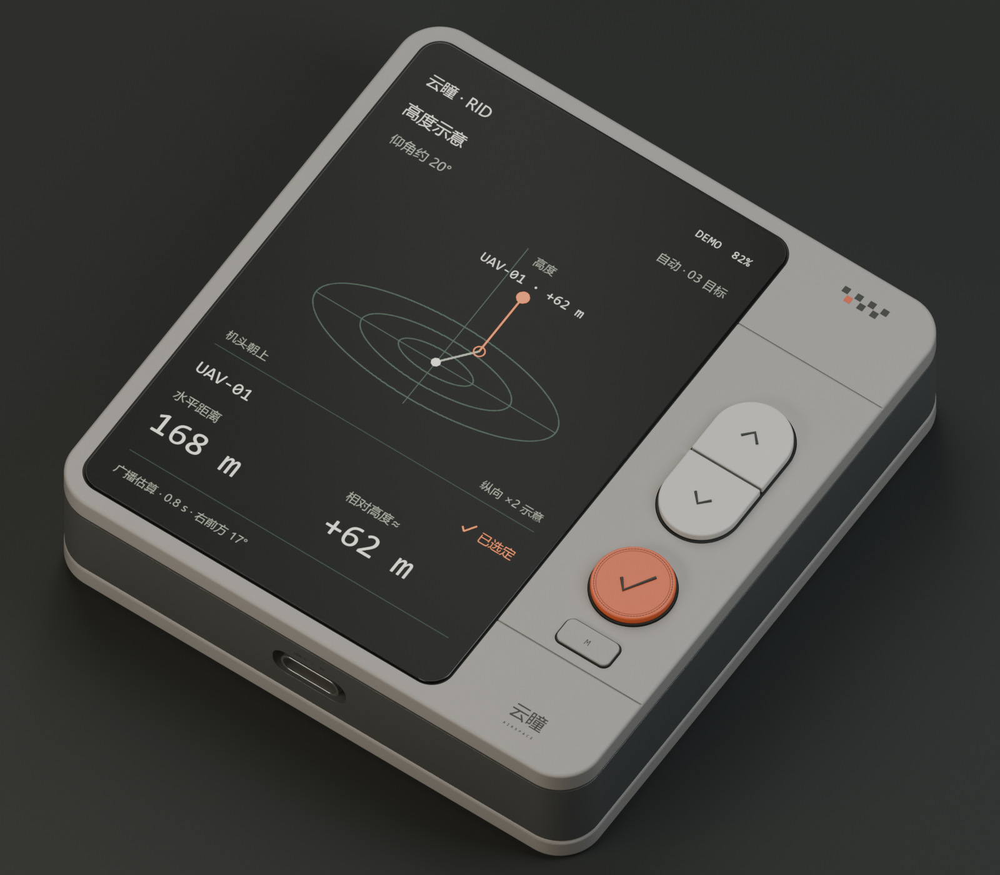

# 云瞳系统 · RID 手持项目

`handheld` 是云瞳手持接收器的研发集成分支，汇合 V4 结构、P4/C6 接收固件与点屏资料。路演站由 `main` 发布，UAVGuard 双摄监测系统与前端源码也可在本分支查看。



**RIG-P1 V4 使用现有细长 ESP32-P4-WIFI6 带排针版和 MSP2834 2.8 英寸 SPI 屏。** [RIG-P1 V4](hardware/rid-handheld-rig-p1/v4/README.md) 沿用 A1 布局，全焊线，底部居中 Type-C 延长座，外壳厚 27 mm，含按键 27.7 mm，待实物试装。后续 3.54 英寸 HY-A354TU102GG 优先用同一块 P4 板验证双通道 DSI。已取得厂家点屏命令，双通道配置和实屏点亮待确认。充电、内置 GNSS、平放雷达与竖持高度视图为整机目标。

| 入口 | 内容 |
|---|---|
| [当前 V4 可打印试装壳](hardware/rid-handheld-rig-p1/v4/README.md) | 28 mm 内、焊线、居中 Type-C，Blender / GLB / STL / 实际网格检查 |
| [Claude 接手 README](README_CLAUDE_HANDOFF.md) | 用户决策、历史版本、硬件候选、Blender MCP 接入与限制 |
| [选定屏幕 HY-A354TU102GG](hardware/display-hy-a354tu102gg/README.md) | 规格书、V01 点屏说明、P4 双通道可行性和轻薄载板路线 |
| [ID-A1](hardware/rid-handheld-id-a1/README.md) | 原图长屏比例、可编辑 Blender/GLB、渲染与生成脚本 |
| [ID-A2](hardware/rid-handheld-id-a2/README.md) | 2 英寸时期的正面包覆铝壳与贝塞尔圆角参考 |
| [ID-A3](hardware/rid-handheld-id-a3/README.md) | 旧 320 × 480 屏的二维外观包络与 UI 草案；需按新屏重新适配，尚无对应 Blender 模型 |
| [两种竖式材质](output/rid-rams-portrait-v2-2026-10-30/README.md) | 铝框 + SLA 前后盖 / 全 SLA 外壳概念图 |
| [P4/C6 固件](hardware/rid-handheld-evt1/firmware/p4/README.md) · [空口闭环记录](hardware/rid-handheld-evt1/validation/REAL_AIR_LOOPBACK_HANDOFF.md) | ILI9341 台架接收合成 RID 的记录与主机测试 |
| [EVT1-A0](hardware/rid-handheld-evt1/README.md) | 早期电路、器件包络、CAD、固件骨架与验证记录 |
| [Git 使用与资产管理](docs/GIT_WORKFLOW.md) | 获取分支、下载 LFS 模型、日常提交与交接 |

克隆本分支（需先安装 Git 和 Git LFS）：

```bash
git lfs install
git clone --branch handheld https://github.com/66wyx/yuntong-roadshow.git
cd yuntong-roadshow
git lfs pull
```

## 关联项目：UAVGuard 校园双摄无人机识别与三维定位

这是一个面向两台固定海康网络摄像机的可运行MVP。系统从双路RTSP或
离线/合成视频中提取小型运动目标，建立二维轨迹，通过极线约束和稀疏
三角测量恢复校园ENU三维坐标，再用恒加速度卡尔曼滤波形成确认轨迹。

当前代码已经包含：

- 双路视频接入、断流状态和演示信号源；
- 三帧差分、MOG2、天空掩膜、微振动补偿和3/5二维确认；
- 时间门限、极线匹配、DLT三角测量、非线性重投影优化和误差协方差；
- 5/8三维轨迹确认、类别投票、告警Webhook和SQLite事件库；
- REST、WebSocket、双画面MJPEG和ENU俯视监控页面；
- 内参、外参、闪灯同步和RTK轨迹评测工具；
- Docker部署、现场配置、训练和验收说明。

## 能力边界

现有6 mm镜头不能在整个100–300米范围内保证小型无人机分类。系统按以下
分级输出，像素或置信度不足时必须返回`unknown`：

- 100–150米：0.5米多旋翼的分类与三维定位区；
- 150–250米：小目标探测、跟踪和定位区；
- 250–300米：1米以上固定翼目标扩展区。

代码不包含干扰、截控或自动反制。`models/`中不会附带伪造权重；现场模型
必须在完成合规飞行采集、按飞行批次隔离数据集并通过验收后部署。

## 本地演示

新增独立的[云瞳 AIRSPACE 三维监控前端](frontend/README.md)，包含模拟轨迹、双路视频布局、云台确认面板、事件中心与现有 API 的接入入口。原有后端与基础页面保持不变。

Windows PowerShell：

```powershell
python -m venv .venv
.venv\Scripts\python -m pip install -U pip
.venv\Scripts\python -m pip install -e ".[dev]"
.venv\Scripts\uavguard --config config/demo.yaml
```

Ubuntu：

```bash
python3 -m venv .venv
.venv/bin/pip install -U pip
.venv/bin/pip install -e '.[dev]'
.venv/bin/uavguard --config config/demo.yaml
```

打开 <http://127.0.0.1:8080>。演示模式生成两台相距40米的合成摄像机和一条
三维飞行轨迹，用来验证安装、API和几何链路，不代表真实识别准确率。

运行测试：

```bash
pytest
```

## 真实摄像头上线顺序

1. 按[摄像头设置](docs/CAMERA_SETTINGS.md)完成码流、安全和时间配置。
2. 按[现场部署与标定](docs/FIELD_DEPLOYMENT.md)完成安装、控制点测量及标定。
3. 复制`config/production.example.yaml`为`config/production.yaml`。
4. 复制`.env.example`为`.env`，写入完整且URL编码的RTSP地址。
5. 将通过审核的文件保存为`calibration/site-cam01.yaml`和
   `calibration/site-cam02.yaml`；未标记`valid: true`时服务会拒绝启动。
6. 没有模型时先保留空的`classifier.model_path`，完成几何验证；随后按
   [模型训练](docs/MODEL_TRAINING.md)部署ONNX权重。
7. 按[验收与运维](docs/ACCEPTANCE_AND_OPERATIONS.md)完成8小时负样本和受控飞行测试。

## API

- `GET /api/v1/health`
- `GET /api/v1/tracks/active?confirmed_only=true`
- `GET /api/v1/events?limit=100`
- `GET /api/v1/cameras/{camera_id}/frame.jpg`
- `GET /api/v1/cameras/{camera_id}/mjpeg`
- `WS /ws/tracks`
- 交互式接口文档：`/docs`

轨迹坐标为局部ENU米制坐标，x向东、y向北、z向上。每条轨迹同时输出位置
标准差和重投影误差，调用方不得把`candidate`或`unknown`当作确认无人机。

## 项目结构

```text
src/uavguard/       实时检测、几何、跟踪、服务和Web界面
config/             演示与生产配置模板
calibration/        标定格式、合成标定与无效现场模板
tools/              标定、闪灯同步、轨迹评测工具
tests/              几何、检测、跟踪、配置和API测试
docs/               相机、现场、训练、验收与运维手册
```

## 安全与隐私

真实密码只通过`.env`或密钥管理系统注入。生产相机必须处于独立VLAN，禁止
公网访问；生产配置强制使用HTTP Basic口令，并把访问时间、来源、路径和状态
写入审计表。建议在正式环境前置HTTPS反向代理和学校统一身份认证。天空掩膜
应排除宿舍窗户、道路和人员区域。录像保存、提示标识和公安备案由学校保卫及
法务部门按实际系统性质确认。
