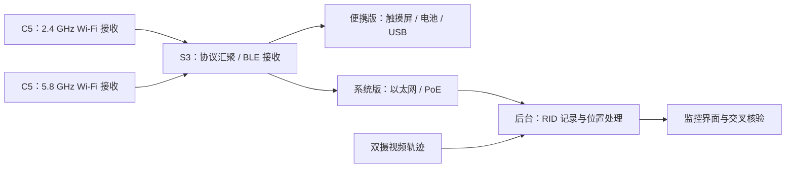

**云瞳 RID 接收与定位模块方案：便携版与系统部署版**

便携版现已确定按侧边实体键版直接制作定制主板验证样机，不采用 CoreS3 过渡验证。外观交互见 [V2 设计稿](RID_HANDHELD_DESIGN_V2_2026-10-29.md)，首板器件、接口与验证顺序见 [EVT1 硬件基线](RID_EVT1_HARDWARE_BASELINE_2026-10-29.md)。下文的手机尺寸、3.5 英寸屏幕、大电池与 GNSS 可选配置属于初稿，便携版以 V2/EVT1 为准。

调研日期：2026-10-29（Asia/Shanghai）。本文是设计建议；尺寸、功耗、费用、工期和验收指标均为待验证的工程目标。本轮完成了仓库、文档和部分接收代码审查，没有进行无线实机测试。

用户确定的顺序：先做实验室便携演示，整机接近手机大小；同时规划系统部署版。建议先做共用接收核心，分别配便携屏幕电池板和部署网络电源板。

建议的首台样机：ESP32-S3 主控与显示/BLE 接收，两个 ESP32-C5 分别接收 2.4 GHz 与 5.8 GHz Wi-Fi，配 3.5 英寸触摸屏、USB-C 和受保护的锂电池。系统版复用协议和数据格式，增加以太网/PoE，接入现有视频后台。上述是待实现的组合设计，现有任一 GitHub 项目都没有直接交付这台完整设备。

**项目现状决定了接入路径。** [公开路演仓库 README](https://github.com/66wyx/yuntong-roadshow/blob/main/README.md)说明，仓库是静态公开交付包，RID、校园坐标和目标轨迹均为模拟内容，不包含接收后端。其 manifest 也把广播控制站点位描述为演示线索。真实功能应在原始工程或独立设备/后台仓库实现，再构建演示或操作界面。

当前本地工作区另外包含 UAVGuard Python/FastAPI 双摄工程和 React 前端，可以作为系统版候选后台；该工作区没有指向上述仓库的 Git 远程，不能据此认定两者已经连通。本方案只涉及广播接收、位置展示、视频交叉核验和运维接口。

两种产品的建议边界如下。

| 项目 | 便携实验演示版 | 系统部署版 |
|---|---|---|
| 主要任务 | 桌面/手持演示接收、查看目标和导出记录 | 固定监测、连续运行、多站汇聚、视频核验 |
| 外形目标 | 约 150 × 75 × 22–28 mm，厚度含电池；先完成布局验证 | 防护小盒，按安装与天线位置确定尺寸 |
| 操作 | 3.5 英寸本地屏幕；USB 连接电脑 | 后台网页、设备管理与告警 |
| 供电 | USB-C 5 V；约 4,000–5,000 mAh 电池 | 标准 PoE 或合适的 PoE 分离器供电 |
| 上行 | USB NDJSON；配置网页作为维护功能 | 以太网，MQTT/TLS 或受认证 HTTPS |
| 接收器自身位置 | 可手动设定实验点；外场版本可加 GNSS | 测量固定点位后配置，无须每站常配 RTK |
| 首期容量目标 | 10 个目标的发现、更新、失联、导出 | 50 个目标输入的处理能力；无线并发另测 |
| 主要验收 | 协议、功耗、体积、界面真实性 | 协议、覆盖、时延、运行稳定性、数据可追溯 |

便携版的外置天线会影响“手机大小”的整机尺寸。首台样机允许短天线，最终若要求完全内置，应重新验证不同握持姿态和整机屏蔽造成的接收变化。建议屏幕和接收部件共用载板，射频先使用有完整资料的模组，减少首轮自研天线和射频板的工作量。

**定位能力来自不同证据，应分别展示。** RID 接收器首先接收航空器主动广播的身份、位置和状态。广播坐标由目标上报，不能等同于接收器独立测得的位置；三台接收器收到同一个位置报文，也不能把同源误差当成三次独立测量来平均。增加接收站主要用于覆盖和连续性。RSSI 适合显示信号强弱，不作为首版测距或三角定位依据。

视频几何位置、RID 上报位置和两者的一致性应分别保存。接收器上的 GNSS 用于接收点位置和授时，不会自动提高目标广播坐标精度。没有 RID 的空中目标仍由视频链路发现；收到 RID 也不等于已经验证身份或获得飞行授权。

协议建议按以下顺序规划。

| 优先级 | 协议/传输 | 设计处理方式 |
|---|---|---|
| P0 | 首批实测设备使用的国标广播，包括 GB 46750-2025 | 单独的协议适配器；逐字段与真实抓包对照 |
| P0 | ASTM F3411 / EN 4709-002 的 BLE、Wi-Fi Beacon | 复用 OpenDroneID 编解码；分别验证 PHY 与射频链路 |
| P1，视首批机型提前 | Wi-Fi NAN | 独立验证 Action/Service Discovery 帧接收与消息提取，不能把 Beacon 解码视为已经支持 NAN |
| 按样本启用 | 国内旧版 GB 42590 相关广播与区域/固件差异 | 使用已记录来源的兼容配置，不仅靠一个字节猜协议 |
| 后续独立接入 | 网络式运行识别 | 使用有权限的服务接口；无线广播接收器不能直接取得监管平台数据 |

[GB 46750-2025 官方信息](https://std.samr.gov.cn/gb/search/gbDetailed?id=42BD8BAE300A08A1E06397BE0A0AB162)显示实施日期为 2026-05-01。其[民航局公布文本](https://www.caac.gov.cn/XXGK/XXGK/BZGF/BZGF_GJBZ/202601/P020260120357575326873.pdf)定义了自己的报文结构、坐标系和位置类型。因此，ASTM 接收成功不能作为新国标接收成功的证明。正式宣称符合标准前，还需按接收段要求与对应证实方法验证，本文的研发目标不替代标准检验。

首批必须建立“机型、区域版本、固件、实际广播协议、频段、信道、BLE PHY”的兼容表。实验发送器与真实无人机至少各提供一种独立样本，避免收发两端共享同一个编码错误而相互验证通过。

GitHub 调研中，建议这样选择组件；成熟度判断来自维护历史、源码与文档范围，不代表本轮已做硬件验收。

| 项目 | 当前可用部分 | 许可证/维护观察 | 本项目建议 |
|---|---|---|---|
| [opendroneid-core-c](https://github.com/opendroneid/opendroneid-core-c) | 国际广播 RID 的 C 编解码、消息模型与测试 | Apache-2.0；调研时最近推送为 2026-10-07 | 国际协议基础库优先选择；不把它当作现成国标解码器或完整接收硬件 |
| [OpenDroneID Android receiver](https://github.com/opendroneid/receiver-android) | BLE、NAN、Beacon 接收与地图参考 | Apache-2.0；存在多机型能力说明 | 用作国际协议交叉核验和交互参考；手机无线/系统限制需单独核对 |
| [Sniffle](https://github.com/nccgroup/Sniffle) | TI CC13x2/CC26x2 上的 BLE 抓取，含扩展广播与 Coded PHY | GPL-3.0；有长期使用积累 | 实验室 BLE 抓包对照工具；自身不等于 RID 应用解码器 |
| [ESP32-ChinaRemoteID_Scan_Sim](https://github.com/sd1471123/esp32-ChinaRemoteID_Scan_Sim) | 国标/ASTM Wi-Fi Beacon 接收代码，S3/C5 实现 | MIT；2026-10-16 创建，调研时仅约两周 | 便携 Wi-Fi 接收原型的主要参考；须补 BLE、NAN、内部接口和回归样本 |
| [dump3411](https://github.com/ifnull/dump3411) | Linux 接收、HTTP JSON、MQTT 和历史记录 | MIT；2026 年创建 | 适合系统版对照验证；当前工具的 Wi-Fi 扫描主要面向 2.4 GHz，BLE 能力取决于适配器；对外 feed 使用英制单位，接入时必须转换 |
| [unix_rid_capture](https://github.com/sxjack/unix_rid_capture) | Linux Wi-Fi/BLE 接收与 JSON/UDP 输出 | MIT；最近推送为 2023-04-20 | 精简参考，不建议无维护改造就作为长期产品基础 |
| [Kismet](https://www.kismetwireless.net/docs/readme/datasources/drone-opendroneid/) | 成熟的无线抓取与诊断基础，新增 RID 解码 | 主项目 LICENSE 默认 GPL-2；RID 文档标注 2026-10 新增 | 外场诊断和抓包工具；不要把主项目历史等同于新增 RID 功能已有长期验证 |
| [DragonSync](https://github.com/alphafox02/DragonSync) | Python 网关、MQTT/状态与外部系统集成参考 | Apache-2.0；社区版与商用套件有区别 | 可参考接口和运维设计，无须为本项目引入整个 WarDragon 生态 |

一个关键排除项是 [droneid-go](https://github.com/alphafox02/droneid-go#license)：其当前 README 明确说明目前不是开源项目。DragonSync 开源不代表其所有上游接收组件都开源。另一个 [china_remote_id](https://github.com/lytsfeng/china_remote_id) 仓库，本轮目录检查只有说明和预编译固件，未看到可审查的源代码及明确许可证，不能作为可维护开源库来选型。对所有实际随产品分发的组件，应保留其许可证和第三方声明，并逐项核对分发要求。

如需要快速购买对照接收器，[NextPilot NP-RID-Receiver 官方文档](https://nextpilot.org/en/docs/manual/datalink/np-rid-receiver.html)提供国标接收及 USB JSON/MAVLink 输出说明，可作为台架对照候选。厂商宣称不等于本轮验证；其 S3 硬件不能补齐 5.8 GHz 接收，文档还说明开启配置热点时会停止 Wi-Fi 广播接收。采购前应确认实际频段、样本机型和数据输出，而不是仅看“支持 RID”的名称。

**便携版建议采用三颗模组的接收核心。** 主控使用 ESP32-S3，承担屏幕、按键/触摸、BLE 接收、消息汇聚与 USB。两个 C5 独立承担 Wi-Fi 的两个频段，并通过串口向主控发送接收数据。S3 的扩展广播/Coded PHY 能力有[乐鑫产品资料](https://www.espressif.com/products/socs/esp32-s3)支持；C5 具有双频 Wi-Fi，但[乐鑫 FAQ](https://github.com/espressif/esp-faq/blob/master/docs/en/software-framework/wifi.rst)说明它不能同时工作于两个频段，因此本设计使用两颗接收模组。



这个设计把双频 Wi-Fi 的接收时间分开，但每颗 Wi-Fi 芯片仍是一次监听一个信道；BLE 1M 与 Coded 扫描也需要验证实际调度和漏包。不能据此宣传同时覆盖所有信道和全部 BLE 广播。首期按抓包结果确定主用信道池，先验证主用信道，再决定固定监听加轮询的策略。若系统版有更严格连续性要求，可增加专用接收通道。

便携固件建议默认只运行接收功能；实验数据回放通过独立输入模式提供，所有导出和显示都标记 `simulated`。正式演示必须能让观众分清“真实无线接收”“历史回放”“软件模拟”。配置热点采用维护模式，完整接收性能在热点关闭的工作模式下验收。

内部接口建议采用带长度、序号和校验的紧凑帧；对外 USB 输出带版本号的 NDJSON。至少保留接收模组 ID、单调时钟、频率/信道、传输类型、RSSI 和原始 RID 载荷。多目标吞吐量先实算再定串口速率，不默认使用 115200 波特率承担所有逐包 JSON。可从 460800/921600 做稳定性测试，或采用更紧凑的内部格式。

目前国标参考项目的 Wi-Fi 回调只接受 Beacon/Probe Response，[代码](https://github.com/sd1471123/esp32-ChinaRemoteID_Scan_Sim/blob/main/main/crid_rx.c)不能证明已经支持 NAN。其接收载荷缓存是 192 字节，较长载荷会被截短，应增加报文最大长度与边界用例。当前接收查看接口主要是 [HTTP `/api/rx`](https://github.com/sd1471123/esp32-ChinaRemoteID_Scan_Sim/blob/main/main/crid_web.c)，本设计需要新增稳定的模组间串口输出，不能直接套用旧版串口监视工具就认为已完成接入。

电池部分应包含充电保护、边充边用电源管理、电量检测和温度/低电告警。5,000 mAh、标称 3.7 V 对应约 18.5 Wh；若整机实测平均功耗为 3 W、可用能量按 85% 估算，理论运行时间约 5.2 小时。因此建议将“屏幕正常亮度下 4–6 小时”作为首期设计区间，等屏幕、连续扫描和转换损耗实测后再定正式续航。模组待机功耗不用于推算连续接收续航。

便携屏幕建议只保留四个工作页面：目标列表、目标详情、接收状态、记录/回放。列表显示 ID、协议、最后位置更新时间与信号；详情区分航空器位置和广播给出的控制站/起飞点位置；状态页显示每个射频通道的接收计数及异常。没有有效位置的目标保留在列表，不在地图上补一个坐标。

**系统部署版保留接收核心，增加设备身份、网络和运维。** 首个部署节点可先以 USB 连现有 Linux/Windows 电脑验证；后续用以太网桥接主控和标准 PoE 供电形成独立小盒。固定安装使用短馈线、合适的双频天线和测量过的节点位置，具体点位由遮挡与无线覆盖测试确定。先部署一站验证协议，再用两至三站填补建筑遮挡，不按地图半径直接推断台数。

部署版至少增加设备心跳、每射频接收计数、异常重启计数、队列丢弃数、软件/配置版本、断网缓存、远程日志与受认证升级。MQTT 的观测消息与设备状态分开；历史重传带原始接收时间和 `replayed` 标志，实时消费者按年龄拒收过期定位。配置网络加密保护节点到后台的数据链路，不把这种保护误认为已经认证了空中 RID 广播。

**两版共用数据模型，比共用外壳更有价值。** 建议分为原始接收记录、规范化 RID 观测、业务轨迹三层。以下只是接口设计示例，`LAB-TEST-001` 为实验标识。

```json
{
  "schemaVersion": 1,
  "observationId": "LAB-OBS-001",
  "receiverId": "HANDHELD-001",
  "protocol": "gb46750_2025",
  "transport": "wifi_beacon",
  "frequencyMhz": 2437,
  "rssiDbm": -60,
  "receivedAtUtc": "2026-10-29T00:00:00Z",
  "messageTimeUtc": null,
  "positionReceivedAtUtc": null,
  "identity": { "type": "serial", "uasId": "LAB-TEST-001" },
  "reportedLocation": null,
  "reportedControllerLocation": null,
  "positionEnuM": null,
  "positionSource": "rid_reported",
  "verification": "unverified",
  "simulated": false,
  "rawRecordId": "LAB-RAW-001"
}
```

位置一旦有效，记录经纬度、原坐标系、原始高度和高度基准，并分别记录位置时间、身份时间、控制站位置时间。协议时间戳按该协议的语义解析，不能统一当 Unix 时间。未知或不可用编码转为 `null`/无效状态，零值是否有效按具体协议判断，不能把未知点画在零经纬度或地面。

坐标处理采用“原始坐标系 → 经审查的统一大地基准 → ECEF → 站点 ENU”。配置校园原点、轴向、高程基准与变换版本。大地高、海拔、气压高度和相对起飞点高度分别保存，未能转换到统一基准时只展示对应原始高度或二维位置。校园 GLB 模型需另外用测量控制点校验尺度、北向、平移和高程；国内地图偏移坐标只用于明确的显示适配，不进入测量与轨迹融合。

目标管理以带协议命名空间的 ID 类型和 UAS ID 为线索，MAC 作为接收属性。会话 ID 不一定能长期绑定到同一航空器。同一 ID 同时出现互不相容的位置时保留冲突，不强行合并。相同报文被多站收到，应形成一个观测及多个接收记录，不重复提高位置置信度。

控制站位置还需保留类型。ASTM 的起飞点、固定位置、实时 GNSS 等语义与国标位置类型不能丢失。界面使用“广播控制站位置”“广播起飞点位置”等明确文字，不能统一写成“已定位飞手”。ID、注册标志、机型类别和实际人员身份也分别处理；无法证实的具体品牌型号保持未知。

**本地后台需要先解除纯双目数据契约的限制。** 现有文件可以按以下职责扩展；以下均为建议新增或修改，并非本轮已经实现。

| 位置 | 改进内容 | 原因 |
|---|---|---|
| `src/uavguard/rid/`（新增） | 协议路由、USB/MQTT 输入、观测校验、去重和来源记录 | 把无线接收与视频处理线程分开 |
| `src/uavguard/geodesy.py`（新增） | 带基准和版本的坐标/高程转换 | 当前后台使用本地 ENU，RID 输入为地理坐标 |
| `src/uavguard/models.py` | 新增 RIDObservation；规划 v2 轨迹中的可空测量字段和证据来源 | 现有 TrackEvent 强制三维位置、协方差和重投影误差，不适合纯 RID 或无高度观测 |
| `src/uavguard/tracking3d.py` 与融合模块 | 保留视觉跟踪，新增时间关联、来源协方差和冲突处理 | 现有更新函数面向 StereoMeasurement，不能原样注入任意 RID 位置 |
| `src/uavguard/app.py` | 新增 RID 接收器/观测接口；规划 v2 统一轨迹和 WebSocket | 当前活动轨迹接口直接读视觉 tracker，没有多源汇聚层 |
| `src/uavguard/storage.py` | 保存设备健康、原始记录引用、规范化观测和关联历史 | 支持重放和查明位置/身份变化原因 |
| `frontend/lib/airspace.ts`、`use-airspace.ts` | v2 校验、位置空值、逐字段年龄和证据状态 | 现有前端要求数值型位置和重投影误差，并按轨迹时间作过期判断 |
| `frontend/components/monitoring-workspace.tsx` | 接收器状态、协议标签、广播/视觉/一致/冲突状态 | 防止模拟数据或未核验广播被显示为已测实位置 |

一个具体风险是当前 `tracking3d.py` 将测量协方差对角线限制在 0.25–400 m²。对精度未知或低精度 RID，直接复用会把输入错误地变成最多约 20 m 标准差的测量。融合应按来源和精度语义处理，保留原始精度等级；95% 精度边界不能不加模型地直接当成一倍标准差。

建议先让 RID 和视觉轨迹并排显示，积累真值和关联样本后再做融合。第一步按时间对齐后的空间邻近、运动方向和连续多次一致性建立关联；一对多时保留歧义。位置明显不符、时间不可信或原始精度未知时不更新高置信轨迹。相邻同 ID 广播与新身份消息不能刷新旧位置的有效期；例如 3 秒未有新位置即标记陈旧，10 秒后退出实时定位列表，历史仍保留。具体阈值应在首批设备的发送周期测试后配置。

旧 `/api/v1` 与现有视频枚举保持兼容；纯 RID 缺失高度、速度或误差时走新增观测接口或 v2，禁止用假的相机 ID、零重投影误差和零标准差满足旧解析器。视频“轨迹确认”、RID“格式有效”、广播“身份已认证”和多源“交叉核验”分别建模。

研发可以按以下顺序排期。工期按一名嵌入式、一名后端，前端/测试参与，且样本设备与采购及时到位估算；射频板或外壳返工需另留时间。

| 时间 | 交付物 | 完成条件 |
|---|---|---|
| 第 1 周 | 模组台架、真实样本和兼容表、三路原始记录 | 分别收到国标样本和国际协议样本；注明尚未覆盖的传输类型 |
| 第 2–3 周 | S3 + 双 C5 的统一数据流与便携界面 | 目标发现/更新/陈旧/失联正确，USB 可导出；BLE 与两路 Wi-Fi 分别和同时验证 |
| 第 4 周 | 手机体积结构样机、电池/功耗记录、实验演示流程 | 实物装入尺寸目标范围或给出机械改版；真实/回放/模拟状态明显可区分 |
| 第 5–6 周 | 系统节点、以太网/PoE、后台观测接口与视频并排展示 | 一站长稳、断网重连、重启恢复、旧接口回归通过 |
| 第 7–8 周 | 多站覆盖图、视频关联评估、试点验收记录 | 有重复观测去重与冲突用例；覆盖和位置误差均有实测数据 |

如果只要第一轮实验演示，可以先完成前四周的便携原型；系统版沿用接收核心继续工程化。不要在真实机型协议未确认前锁定整机 PCB 和量产外壳。

建议以这些指标约束验收，均是研发目标而非已有性能。

| 验收项 | 建议方法与门槛 |
|---|---|
| 协议准确性 | 对已知标准样本逐字段比对；真实抓包与独立工具至少交叉一次；未知值、缺失项、长度边界、扩展位和错误帧不得生成虚假位置 |
| 传输覆盖 | BLE legacy/extended、1M/Coded、2.4/5.8 Beacon 和 NAN 分列；任何未测组合明确标记 |
| 内部延迟 | 从本机完成有效接收到界面/后台发布，P95 目标 ≤ 300 ms；另报从目标采样到接收的年龄 |
| 便携容量 | 10 个目标的记录回放压力测试，再做可获得数量的实机无线测试；两者结果分开 |
| 部署容量 | 50 个目标输入流不阻塞，队列丢弃与导出延迟可观测；不据此声称无线并发已经达标 |
| 位置处理 | 坐标变换用已知点/往返计算验证；目标位置和同步真值比较，分别报告水平/垂直 RMSE、P95、偏差及可用率 |
| 接收覆盖 | 先在 50/100/300 m 实测；再将 500 m/1 km 作为扩展测试点，按协议、频段、机型、朝向和遮挡分别报告 |
| 连续性 | 在声明覆盖的测试路线内，最近位置年龄 ≤ 3 s 的时间占比目标 ≥ 95%；一并列明发射周期和有效飞行时段 |
| 便携续航 | 屏幕亮度和扫描方式固定，满电至受控关机，目标 4–6 h；记录平均/峰值功耗和外壳温升 |
| 系统稳定性 | 先 8 h，再 72 h 连续运行；无崩溃，断网/掉电恢复可追溯，历史重传不冒充实时目标 |
| 交叉核验 | 同 ID 异地、旧位置配新身份、同包多站、双目标交叉等用例不会被错误地当成高置信新位置 |

便携版材料与装配可先预留约 1,500–3,000 元/台，系统固定节点约 1,500–3,000 元/节点，作为原型预算上限讨论的起点。这些是设计阶段的费用估算，不是当前供应商报价，也不包含研发人力、测试仪器、RTK 真值设备、认证、相机、服务器、现场布线和开模。双 C5、屏幕、电池及外壳选择确定后，应再形成有料号和报价的 BOM；现有电脑可先承担系统节点的数据接入验证。

首批采购建议控制在一套 S3 触摸屏主控、两套 C5 外接天线模组、USB/串口调试件、电池电源组件和简单结构件；实验室另备一套可独立核验 BLE 的接收工具。先完成实际广播兼容表、无线接收记录和功耗测量，再决定第二轮 PCB、是否需要独立 BLE 接收模组，以及系统版节点数量。
