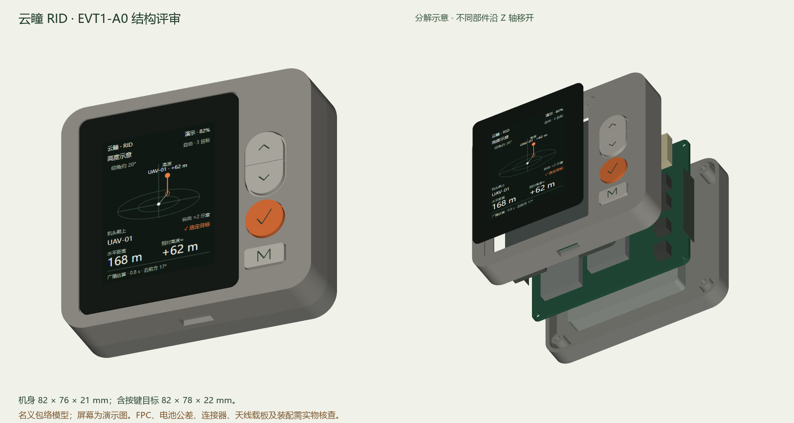

**云瞳 RID 掌上机 EVT1 工程**

外观已由用户要求更新为 [ID-A1：CNC 铝合金中框、打印前后盖](../rid-handheld-id-a1/README.md)，并以参考图细节优先。本目录的 A0 壳体、屏幕和天线占位属于旧基线，需要按新版重新适配。

本目录是直接从用户选定侧边实体键版本开始的首板工程，2026-10-29 建立。主控为定制 ESP32-S3 载板，集成双 C5、GNSS、姿态和地磁传感器，底部 USB-C 充电/数据共口。

当前为工程评审版。机械模型、连接分配与固件测试各自报告验证范围；物理接收、充电温升、射频耦合、天线朝向、续航及装配公差需要首台实物验证。未经完整原理图/ERC、布局/DRC 和电源/射频复核，不作为生产制造包。

机械模型和尺寸图以 `design.json` 为数据源；固件板级头文件由 `electrical/gpio.csv` 生成。关键 BOM 单独维护并标明来源与选型状态。原始供应商尺寸、结构预留及待确认料号分别标明。

| 文件 | 用途 |
|---|---|
| [工程评审与待办](REVIEW.md) | 当前已完成的内容、尺寸风险及释放条件 |
| [STEP 装配](mechanical/generated/rid-handheld-evt1-a0.step) / [GLB 预览](mechanical/generated/rid-handheld-evt1-a0.glb) | 29 个命名实体；主板与电子器件均为包络 |
| [正面控制图](mechanical/generated/front-dimensions.svg) | 外观、按键、屏幕及接口尺寸 |
| [厚度分配](mechanical/generated/stack-dimensions.svg) / [器件位置](mechanical/generated/component-placement.svg) | 机械堆叠及主板占位 |
| [关键 BOM](electrical/key-bom.csv) / [GPIO](electrical/gpio.csv) / [电源与接口架构](electrical/ARCHITECTURE.md) | 详细原理图的设计输入 |
| [按键和 UI](interface/INTERACTION.md) | 240 × 320 双视图、按键与异常状态 |
| [固件工程](firmware/README.md) / [验证记录](validation/validation-report.json) / [实机验收表](validation/BRINGUP.md) | 主机测试与尚待上板验证的范围 |

入口：

- `design.json`：包络、堆叠和器件摆放基线。
- `electrical/`：关键 BOM、主控 GPIO、接口/电源连接说明。
- `mechanical/`：可编辑建模脚本、结构文件和尺寸图。
- `firmware/`：可在主机验证的核心逻辑与 ESP-IDF 启动工程。
- `validation/`：自动检查结果和实机上电验收表。

设计状态和待确认项以本目录的评审报告为准。屏幕、天线与电池装配空间不得仅凭交互示意图确定。

复现：Python 3.11+，安装 `mechanical/requirements.txt`；依次运行 `mechanical/build_cad.py`、`mechanical/verify_exports.py`。逻辑测试执行 `python tools/run_checks.py --compiler /path/to/zig`，或不带参数使用 PATH 中的 C++17 编译器。结构 STL 的单位按 mm 导入，文件名 `fit_prototype` 表示试装用途。渲染脚本为可选项，见其文件头说明。
