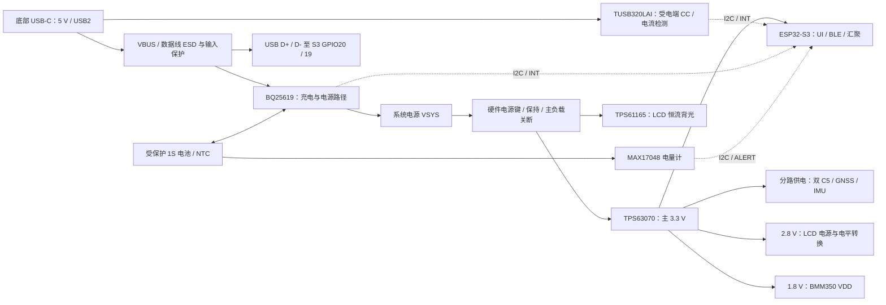

**EVT1-A0 电源与接口连接基线**

这是原理图设计输入。关键器件已选到候选订货号，完整原理图、外围 R/C/L、封装、ERC、铜箔布局、DRC 和电源计算尚未完成。不要从这份架构图直接生成打板订单。

底部一个 Type-C 同时负责充电、供电和原生 USB 数据，首版为 5 V 受电端，不申请高电压 PD 档位。必须兼容 A-to-C / C-to-C、两种插头方向。CC 控制器的 dead-battery Rd 及电流识别按其正式参考电路实现，不能无条件再并一组 Rd。

输入限流先按未识别/USB 未配置 100 mA、默认 USB2 已配置 500 mA、可靠识别 1.5 A / 3 A 时上限 1.5 A 的保守策略设计。**这些是软件政策上限，并非已设置到充电芯片的寄存器值。** 最终要同时受输入线材、充电器规格、保护与热设计、电池能力约束。USB 电力不足时由电池补足或降低负载，不能假定电脑口能带动三路接收与背光并同时充电。

支持边充边用与关机充电：充电、电量计和 CC 属于必要常供电域；主控、无线、显示属于可关闭负载。BQ25619 的 BATFET/ship mode 不能单独保证插 USB 时主系统仍关闭，须补足独立硬件关断、开机保持和强制恢复路径。关机先停止记录并保存，再释放 SYSTEM_HOLD。USB、串口、I2C 和控制脚必须检查关机时的反向供电。

关机充电指示从充电芯片真实状态产生，不能依赖已断电的 S3。正在充电、空闲、充满、故障的指示逻辑需逐态验证；单一 STAT 灯熄灭不能直接标为“已充满”。开机后 UI 的电量百分比来自电量计，充满来自充电状态机，通信异常分别显示未知。

**屏幕电气是当前的释放阻塞项。** DT024ETFT-IPS 的供应商 PDF 标称 2.8 V 逻辑/模拟电源，推荐上限 3.3 V；背光为约 8.4–9.9 V / 总 40 mA 的 LED 串联负载，需要恒流升压。不能把 LED-A 直接接 3.3 V。候选 TPS61165 + 输出电平转换 SN74AXC8T245 仍需核算电流、调光、关闭状态和外围。

供应商接口选择表与 SPI 产品描述存在不一致，IM0/IM1 不能凭经验接死。J_LCD 推荐 Molex 5051101592，触点面、FPC 朝向及实际引脚必须与样品对照。LCD 不使用读回，TE 先留测试点，确认四线模式后使用 DC；未确认前不发布 LCD 驱动或原理图。

BMM350 VDD 需要约 1.8 V 的独立电源域；VDDIO 和 I2C 上拉依数据手册确认，不能将所有电源脚直接接 3.3 V。GNSS、IMU、地磁、充电器、CC 和电量计的 I2C 地址、拉电流与掉电引脚状态需在电路设计时列表核对，必要时分总线。

GPIO 初表见 `gpio.csv`，生成头文件见 `../firmware/s3/main/board_pins.hpp`。当前检查了唯一性、模组引脚范围和 S3 octal PSRAM 的 GPIO35/36/37、启动脚避让；尚未完成引脚电气/ERC。C5 UART0 TX=GPIO11 / 模组脚25，RX=GPIO12 / 脚24；C5 N8R8 的 GPIO15 不作外设口。每颗模块保留 EN/BOOT/UART/USB 恢复测试点，日志与数据 UART 分离。

射频：两颗 C5 分频段工作，各自仍只监听一个信道。三条内置 FPC 天线及 GNSS 贴片的位置是几何占位，不等于有效射频设计。GNSS 接地载板、馈点、同轴弯曲、天线净空、握持遮挡与近距离耦合尚未验证。磁力计需比较 USB 充电/不充电、背光不同档位、三路无线开关时的航向偏移。

完整 BOM 还要补：各电源域 LDO/负载开关与保持电路、晶体/匹配/滤波、ESD、R/C/L、LED、按键开关和电池连接器等。`key-bom.csv` 是关键选型清单，不是齐套采购单。TPS63070 的开关电流额定值也不能当成该条件下的连续输出电流。

厂家原始链接集中在 `key-bom.csv` 和 `design.json`。屏幕参考：[产品](https://www.seacomp.com/product/2-4-inch-tft-lcd-dt024etft-ips)、[规格书](https://www.seacomp.com/sites/default/files/datasheets/DT024ETFT-IPS-Displaytech-Spec.pdf)。电源参考：[BQ25619](https://www.ti.com/product/BQ25619)、[TUSB320LAI](https://www.ti.com/product/TUSB320LAI)、[TPS63070](https://www.ti.com/product/TPS63070)。
