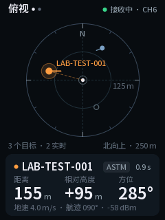
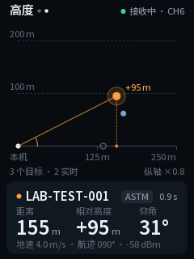
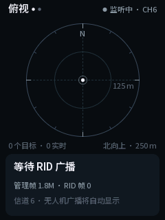
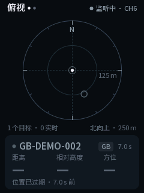
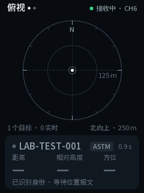

# ESP32-P4 real-air RID receiver

This is the bench receiver used to validate the ESP32-P4 + ESP32-C6 bring-up.
It listens in promiscuous mode on Wi-Fi channel 6, recognizes RID vendor
elements, decodes ASTM/OpenDroneID and GB 46750-2025 observations, maintains
target state, and renders the radar/height UI on an ILI9341V panel.

This directory is bench validation firmware. It is not yet the EVT1 production
firmware.

## Dependencies

- ESP-IDF 5.5
- `espressif/esp_hosted` 2.11.7
- `espressif/esp_wifi_remote` 1.6.5
- Custom C6 firmware from [`../c6`](../c6), normally installed through
  [`../c6-ota`](../c6-ota)

## Build and monitor

```bash
idf.py set-target esp32p4
idf.py build
idf.py -p /dev/ttyACM0 flash monitor
```

On Windows the tested port was `COM3`:

```powershell
idf.py -p COM3 flash monitor
```

At boot the firmware prints:

```text
RID capture active on channel 6
stats mgmt=<n> rid=<n> decoded=<n>
```

For a valid RID frame it prints `RID_FRAME` followed by `RID_TARGET`, including
protocol, identity, source MAC, WGS84 position, geodetic altitude, broadcast
height, ground track, and receiver-local XYZ. The stats line also reports
`ui_us`, the time spent drawing and flushing the last frame.

XYZ is east/north/up from the receiver anchor in
[`main/rid_geo.c`](main/rid_geo.c) (`22.6000000, 114.3000000, 0 m`). Z is
target geodetic altitude minus receiver altitude, so it is the height relative
to the receiver. The broadcast `height` field is relative to take-off or ground
and is logged but never shown as relative height. Until EVT1 has GNSS, keep the
anchor equal to the transmitter's `--origin-*` arguments.

## UI

| Plan view | Height view | Waiting |
|---|---|---|
|  |  |  |

| Position stale | Identity only |
|---|---|
|  |  |

These are the exact framebuffers produced by `rid_ui_draw()` on the host, using
synthetic targets; they are not panel photographs.

- The plan view is north-up. EVT0 has no magnetometer, so nothing is labelled
  relative to the device heading. Bearing is true north, clockwise.
- The range ring scales to the farthest live target (50 m to 10 km). Targets
  beyond the outer ring stay on the edge as hollow markers.
- Orange marks only the selected target. Without input keys it is the nearest
  live target. Other live targets are blue; stale ones are grey rings.
- The height view is a side profile with labelled height and distance grids. Its
  vertical exaggeration is always shown (`纵轴 ×N` or `纵横等比`).
- Values that are missing or older than 3 s show as `—`, and the card explains
  why: no position yet, or position expired.
- Pages alternate every 5 s, as before.

Drawing is split from the panel. [`main/rid_gfx.c`](main/rid_gfx.c) provides
anti-aliased lines, rings, arcs, rounded rectangles, and 4-bit text into an
RGB565 framebuffer. [`main/ili9341.c`](main/ili9341.c) only initializes the
panel and flushes that buffer.

### Fonts

[`main/ui_font_data.c`](main/ui_font_data.c) is generated from Noto Sans SC
(SIL OFL 1.1, see
[`../p4-prototype/NotoSansCJK-OFL-1.1.txt`](../p4-prototype/NotoSansCJK-OFL-1.1.txt)).
The generator collects every string literal in `rid_ui.c` plus all printable
ASCII, so new UI text cannot silently render as `?`:

```bash
python tools/gen_ui_font.py --font /path/to/NotoSansSC-VF.ttf
python tools/gen_ui_font.py --check    # fails if any UI character is missing
```

## Display wiring

The tested module is LCDWiki MSP2834: ILI9341V, 240 x 320, with an ST7796
compatible timing path retained only as an alternative.

| LCDWiki signal | ESP32-P4 |
|---|---|
| VCC | 5 V / VBUS |
| GND | GND |
| LCD_CS | GPIO20 |
| LCD_RST | GPIO21 |
| LCD_RS / DC | GPIO22 |
| SDI / MOSI | GPIO23 |
| SCK | GPIO26 |
| LED / BL | GPIO27 |
| SDO / MISO | GPIO32 |
| SD_CS | Not connected |

The FT6336G touch controller is intentionally not part of this firmware's
acceptance path. The display and all RID UI checks are touchless.

## Host-side checks

The decoder, geometry, graphics, fonts, and UI are plain C11 with no ESP-IDF
dependency. One command builds them with `-Werror`, then runs the C unit tests
([`host/rid_host_tests.c`](host/rid_host_tests.c)), the ctypes fixture test
against [`../../tools/virtual-rid-tx/rid_fixtures.py`](../../tools/virtual-rid-tx/rid_fixtures.py),
and the font coverage check. It can also re-render the screenshots above:

```bash
python3 tools/host_check.py --preview-dir docs/ui
# without a system compiler:
python -m pip install ziglang==0.13.0
python tools/host_check.py --cc "python -m ziglang cc" --preview-dir docs/ui
```

Expected final line:

```text
P4 host checks passed
```

Passing these checks validates parsing and rendering only. It is not evidence of
real-air RID reception.

## Current evidence

- The real P4/C6 link started successfully over SDIO.
- Channel 6 promiscuous capture counted more than 1.8 million management
  frames across a long bench run.
- No RID frame was observed because the PC transmitter did not complete the
  MT7612U monitor-mode initialization in the tested QEMU path.
- The C decoder fixtures passed.
- The ILI9341 initialization succeeded on the bench panel with the previous UI.
  That UI's circles were mis-drawn and several labels rendered as `?`.
- The redesigned UI builds with ESP-IDF 5.5.2 and passes the host checks. It
  has not yet been flashed to the panel, and decoded aircraft rendering still
  awaits a successful transmitter.

See [`../../validation/REAL_AIR_LOOPBACK_HANDOFF.md`](../../validation/REAL_AIR_LOOPBACK_HANDOFF.md)
for the full evidence and remaining blocker.
