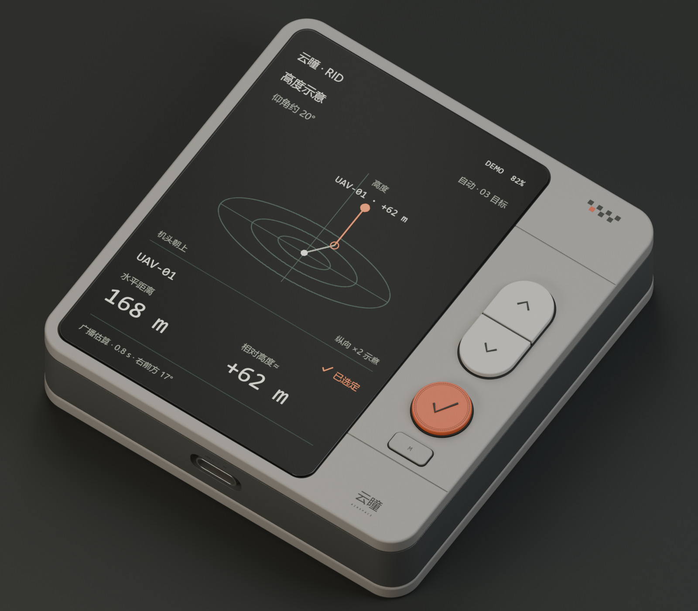

**云瞳 RID · ID-A1 外观设计**

本版响应“外观优先、CNC 铝合金中框、上下盖 3D 打印”的要求，使用 Blender MCP 建模与渲染。外观目标为 82 × 86 × 20 mm（不含突出按键）；恢复参考图略偏竖的比例、窄黑屏边、横向分缝、棋盘标记与精细按键。

文件入口：

- `blender/yuntong-rid-id-a1.blend`：原生可编辑模型、材质、相机、三种屏幕与拆分动画。
- `blender/yuntong-rid-id-a1.glb`：便于快速查看的装配外观模型；程序材质以 Blender 文件为准。
- [细节总览](renders/09-detail-board.png) / [参考风格与 RID 对照](renders/10-reference-and-rid.png)：实际 Blender 渲染的评审拼板。
- `renders/`：八张单独渲染图，包括正面、三分之四、原图风格对照、按键近景、Type-C、后盖、拆分图与雷达界面。
- `DESIGN_NOTES.md`：参考细节对照、材料工艺方向、功能补充和设计边界。
- `id-brief.json`：本版外观参数与约束。
- `scripts/`：屏幕艺术稿生成脚本及通过 Blender MCP 执行的建模/场景脚本。
- `assets/`：原始参考图的未修改副本，以及三张独立生成的屏幕艺术稿。

打开 `.blend` 后选择场景 `RID_ID_A1_Studio`。时间轴第 1 帧为装配，第 60 帧为拆分；前后盖按分组移动，中框保持原位。产品各部件有独立名称和材质，原始参考图保存在隐藏的 `ID-A1 | Supplied references` 集合。高度、雷达和参考图三张屏幕是互斥的视觉稿，可切换 `Screen_height` / `Screen_radar` / `Screen_reference` 的显示与渲染开关。

灰色前后盖是打印聚合物效果，中框为细喷砂灰色铝合金效果，橙色按键带同心细圈和边缘刻纹。M 键、顶部电源键、Type-C、背面防滑与螺钉是为本产品补充的设计；参考图未展示的侧背面没有宣称逐项复刻。

本目录替代 A0 的外观比例和壳体材料假设。A0 的电路/固件工作保留为研发输入，但显示选型、PCB、电池和天线需要按本版外形重新适配。此处的 `.blend` / `.glb` 是 ID 模型，并非 CNC 或打印生产文件；屏幕数据均为演示。

检查记录见 `geometry-review.json` 与 `file-review.json`：9 个主要壳体/按键/盖板网格均无非流形边，GLB 包含 153 个本产品网格，5 张图像已打包入 Blender 文件。检查范围为模型与文件完整性，不代表制造或射频通过。
