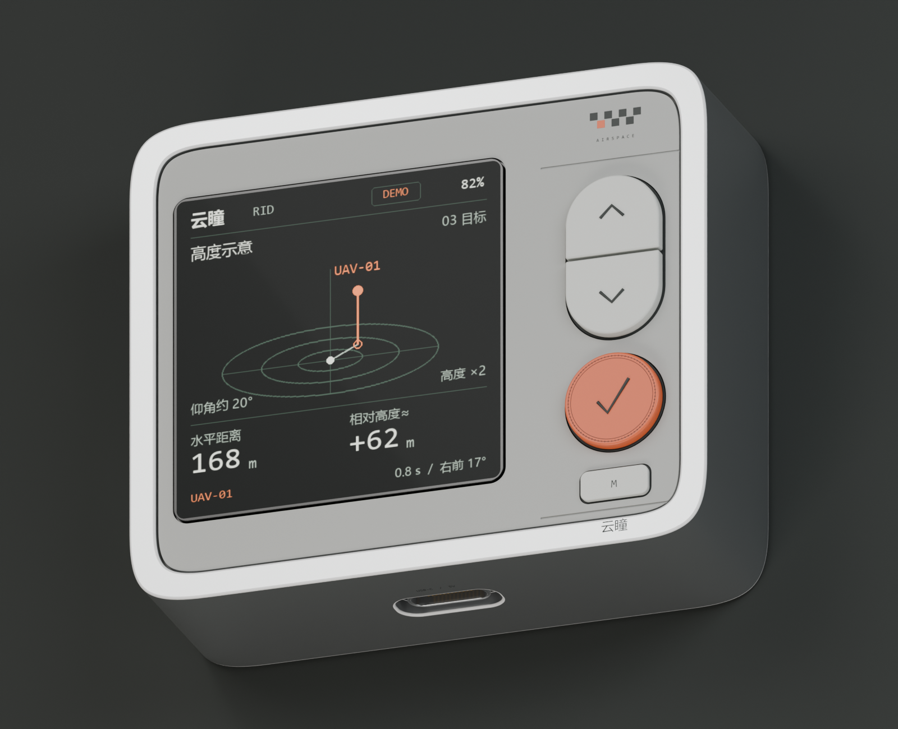

# 云瞳 RID · ID-A2

2026-10-30。本版按 AM200Q460460FLS1 方形屏重做外形，并落实包覆正面的 CNC 铝壳与连续曲率四角。外观评审版，尚未冻结内部装配和加工图。

- **外壳**：64 × 54 × 20 mm 为当前机身目标，不含按键突出量。铝侧壁与正面金属围边是一体结构；正面直边金属宽约 2.9 mm。
- **四角**：每角由两段三次贝塞尔曲线构成，进入直边处曲率为零，两段曲线中间二阶连续。采用参考 iPhone 观感的原创参数，不是苹果原厂尺寸。外壳、正面内框和打印面板沿用同一曲线构造。
- **材质层次**：自然银色阳极氧化铝壳，细喷砂表面、细亮边；灰色打印前面板下沉 0.35 mm，打印后盖下沉约 0.30 mm。取消上下盖压在中框外面的横向夹层外观。
- **屏幕**：AM200Q460460FLS1 / 2.0 英寸 / 460 × 460 / QSPI。按 35.88 mm 方形有效显示区重排 UI，保留供应商玻璃台阶。显示数据均为 DEMO。
- **细节**：保留七格标识、橙色小方格、分体胶囊上下键、橙色确认键及双细环和 80 条刻纹、小 M 键、分隔细槽、顶部电源和底部 Type-C。

## 查看文件

| 文件 | 内容 |
|---|---|
| [Blender 原文件](blender/yuntong-rid-id-a2.blend) | 活动场景 `RID_ID_A2_Studio`；保留 A1 场景；第 1 帧装配、第 60 帧分解 |
| [GLB](blender/yuntong-rid-id-a2.glb) | 仅导出 A2 装配，包含嵌入贴图和几何字标 |
| [圆角近景](renders/04-continuous-corner.png) | 铝外沿、内框、打印面板的曲线层次 |
| [三次贝塞尔轮廓 SVG](references/id-a2-bezier-contours.svg) | 保留精确三次曲线命令；用于外观尺寸讨论，不是加工图 |
| [细节评审板](renders/10-design-board.png) | 正视、圆角、接口与背面 |
| [设计说明](DESIGN_NOTES.md) | 尺寸、曲线定义、按键与后续装配约束 |
| [几何检查](geometry-review.json) | 主要实体封闭性、体积和曲线连接误差 |
| [屏幕规格书](references/AM200Q460460FLS1.pdf) | 本次采用的 QSPI 型号原始资料 |

Blender 的 `ID-A2 | Construction` 集合保留可编辑的原始贝塞尔控制曲线，默认隐藏。渲染实体是曲线采样后的网格，不能直接作为 CNC 工程曲面交付。

## 范围

本版完成外观、屏幕包络、接口外形和展示用 UI；没有验证 GNSS 天线、RID 收发硬件、PCB、电池、Type-C 充电电路或真实定位。金属包壳会影响天线，打印面板与后盖的 RF 窗口和整机装配需在下一轮布置中核实。FPC 仅为折返位置示意。

[A1 历史版本](../rid-handheld-id-a1/README.md)保留；[EVT1-A0](../rid-handheld-evt1/README.md)中的旧外壳尺寸、屏幕和天线位置不能直接套用。
