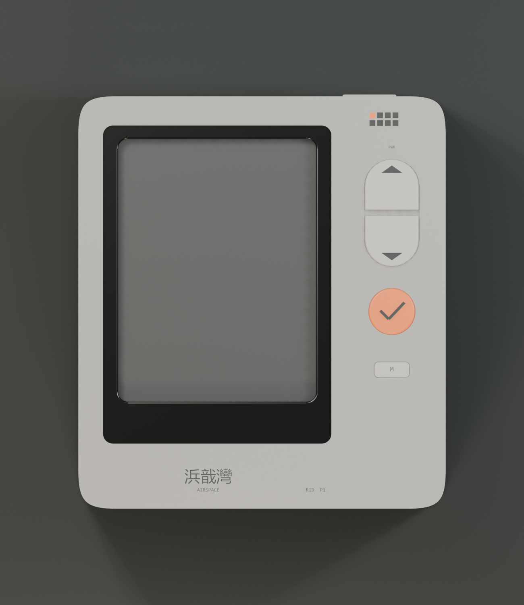
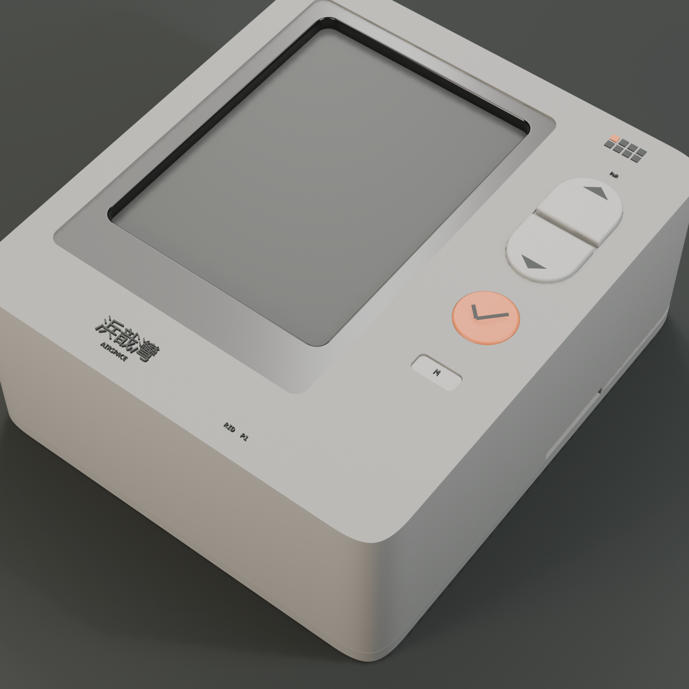
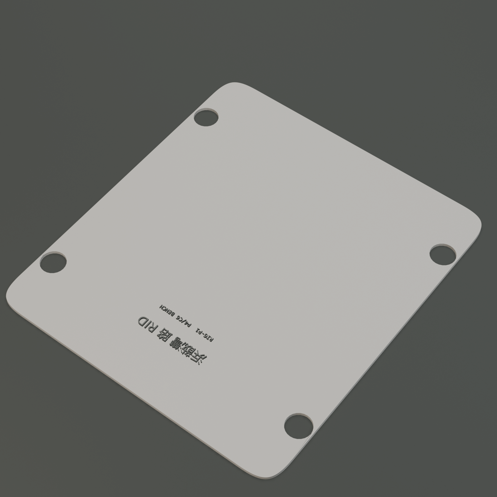

# 云瞳 RID · 可打印测试壳 RIG-P1（A1 布局版）

> **当前版本：[V4 · 28 mm 内焊线试装壳](v4/README.md)。** 用户确认照片中的细长 ESP32-P4-WIFI6 带排针版，屏幕总高 14、开发板总高 14.5，焊线连接，底部居中 Type-C 延长座。V4 外壳厚 27、包含按键 27.7 mm。下文为旧版历史，包含已纠正的宽板/RJ45 和屏幕偏移假设，不应据此打印或采购。

日期：2026-11-05　状态：`printable_first_prototype`

本版按 ID-A1 的正面布局重做：**左侧黑色玻璃、右侧控制列**，机身 82 × 92，前盖下沉 0.6，
右列放上下摇杆、橙色确认键、M 键，顶部电源键，底部字标。屏幕上的一切按华御/全动
MSP2834 的厂商尺寸图（`2.8inch_SPI_Module_MSP2834_Size.pdf`，2023-06-02 Rev V1.0）重算。

> 上一版（背板外露的“测试台架”方案）按用户反馈作废，仓库历史里仍可查到。

## 1. 屏幕的真尺寸（来自厂商图）

| 项目 | 数值 | 说明 |
|---|---|---|
| PCB | 50.00 × 86.00 × 1.60 | 4 个 Ø3.20 孔，孔距 44.00 × 76.08 |
| 触摸盖板 / 背光外形 | 50.00 × 69.20 | 顶边距 PCB 顶边 **3.00** |
| 触摸可视窗 | 43.60 × 58.05 | 顶边距 PCB 顶边 **6.20** |
| 显示 AA | 43.20 × 57.60 | 顶边距 PCB 顶边 **9.60** |
| 前段总厚 | 4.30（1.0 + 0.5 + 2.3 + 0.5） | 到 PCB 正面 |
| 14P 排针 | 2.54 × 13 间距 = 33.02，高 **11.17**（总高 14.28） | 之前按 8.5 算是错的 |

因此模块在机身里的位置是算出来的，不是估的：VA 中心对上开窗中心，
PCB 中心落在 (−10.0, −0.57)，PCB 顶边 +42.43、底边 −43.57。

## 2. 正面布局（照 A1）

| 元素 | 尺寸 / 位置 |
|---|---|
| 机身 | 82.0 × 92.0 × 37.0，四角 G2 连续曲率（L = 9.2） |
| 黑玻璃前盖 | 54.0 × 74.0 × 2.8，中心 (−10.0, +4.0)，下沉 0.6，四周 0.3 缝 |
| 开窗 | 44.2 × 58.65，圆角 R2.2，中心 (−10.0, +7.2) |
| 右侧控制列 | 24.0 宽（x +17…+41） |
| 上下摇杆 | 12.4 × 24.0 胶囊，中缝 1.2，中心 (29, +20) |
| 橙色确认键 | Ø10.5，中心 (29, −2) |
| M 键 | 8.0 × 3.6，中心 (29, −15) |
| 电源键 | 12.0 × 3.4，顶边 x = 24 |
| 字标 | “云瞳 / AIRSPACE” 左下，“RID P1” 右下，棋盘标右上（一格橙） |

## 3. 零件

| 编号 | 零件 | 尺寸/mm | 体积/cm³ | 打印姿态 | 支撑 |
|---|---|---|---|---|---|
| F01 | 前盖（黑） | 54.0 × 74.0 × 2.8 | 3.87 | 正面贴床 | 无 |
| F02 | 机身（暖灰） | 82.0 × 92.0 × 34.0 | 38.2 | 正面贴床 | 无 |
| F03 | 后盖（灰） | 82.0 × 92.0 × 15.2 | 17.0 | 背面贴床 | 无 |
| F04 | 摇杆座（深灰） | 14.2 × 25.8 × 1.2 | 0.39 | 平面贴床 | 无 |
| F05 | 摇杆上/下帽 | 12.1 × 11.4 × 2.9 | 0.35 ×2 | 平面贴床 | 无 |
| F07 | 橙色确认键 | Ø10.5 × 2.3 | 0.19 | 平面贴床 | 无 |
| F08 | M 键 | 8.0 × 3.6 × 1.4 | 0.04 | 平面贴床 | 无 |
| F09 | 电源键 | 12.0 × 3.8 × 3.0 | 0.13 | 平面贴床 | 无 |

五金：4 × M3 × 12 自攻（后盖 → 机身两侧厚壁）。

## 4. Z 向堆叠（正面 +37，背面 0）

| 层 | Z/mm |
|---|---|
| 机身正面 | +37.0 |
| 前盖正面 / 背面 | +36.4 / +33.6 |
| 触摸 / LCD / 模组 PCB | +32.6 … +27.7 |
| 排针尖端 | +16.53 |
| P4 板正面（贴着显示排针一侧） | +15.2（板 13.6…15.2） |
| 后盖 | 0 … 3.0 |

关键间隙：排针尖到 P4 板 1.33；P4 板最低元件到后盖背面 0.1；屏模组左右各 13.4 余量。

## 5. 装配顺序

1. **前盖**：从前侧放进 54.6 × 74.6 下沉槽，落在 +33.6 的槽底，贴 3M 双面胶固定（本版不设前唇）。
2. **屏模组**：从前盖背面窗口贴 0.5 mm 泡棉胶，MSP2834 的触摸面对齐窗口压上；模组从后腔装入。
3. **P4 板**：先拧到后盖四根 Ø6 立柱上（4 × M2.5 × 8，螺头只落在板四角焊盘）。
4. **合壳**：后盖连带主板上抬，4 × M3 × 12 从机身两侧厚壁拧入；排线经后盖过线槽接屏。
5. **按键**：摇杆座、两个摇杆帽、橙色确认键、M 键从正面压入各自的孔；每个键背后贴一只
   6×6×5 轻触开关（热熔胶固定在面板内壁），四根杜邦线接到 2×20 排针。
6. **电源键**：从顶边塞入。

## 6. 打印

| 项目 | 建议 |
|---|---|
| 材料 | PETG（推荐）/ PLA+ |
| 喷嘴 / 层高 | 0.4 / 0.2（草稿 0.28） |
| 壁 / 顶底 / 填充 | 3 圈 / 3 层 / 15% |
| 支撑 | 全部关掉 |
| 附着 | 机身 8 mm brim |
| 估时 | 机身 ≈ 3.5 h、后盖 ≈ 1.3 h、前盖 ≈ 0.6 h，全套约 6 h（0.28 层高约 4 h） |

## 7. 已知问题 / 待确认

1. **机身 STL 有 48 条非流形边**（布尔与圆角相交处），切片软件会自动修复；若要严格水密，
   导出前把机身的倒角修改器关掉重导即可。
2. 机身 37 mm 厚，是 11.17 排针 + 13.5 RJ45 决定的。把排针剪到 8 mm 可收到 34 mm；
   改用 0.5 mm FPC 接口可收到 27 mm 左右。
3. P4 板四角孔可能被 RJ45 / USB-A 本体盖住（厂商图未标），装配前用实物确认；
   被盖住的孔改用定位柱不拧螺丝。
4. 按键是我按 A1 版式补的，**台架固件目前不读按键**，需要自备 3 只轻触开关并接线。
5. 端口开口（顶部 RJ45 + 双 USB-A，右侧 Type-C + BOOT/RST）按厂商包络开，实物可能有 1–2 mm 偏差。

## 8. 文件

| 路径 | 内容 |
|---|---|
| `stl/` | 9 个 STL，单位 mm，各自已翻到打印姿态、底面落在 z = 0 |
| `blender/yuntong-rig-p1-v2.blend` | Blender 5.2 场景（材质、五台相机、1→60 帧爆炸） |
| `blender/yuntong-rig-p1-v2.glb` | 整机预览 |
| `renders/` | 正面、主图、背面、细节、爆炸 |
| `scripts/01_build_blender.py` | 参数化建模（改 `BODY`/`PANEL`/`WIN`/`MOD`/`Z` 即改整机） |
| `scripts/02_render_export.py` | 渲染 + STL/GLB 导出（含焊接与水密审计） |

复现：Blender 5.2 里经 Blender MCP 依次跑 `01` → `02`。
