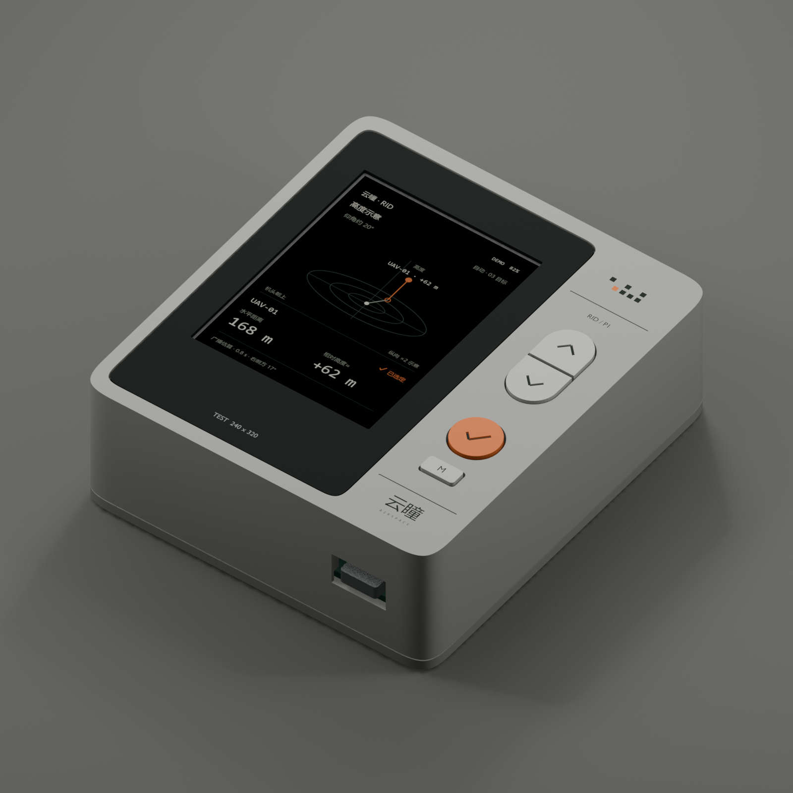
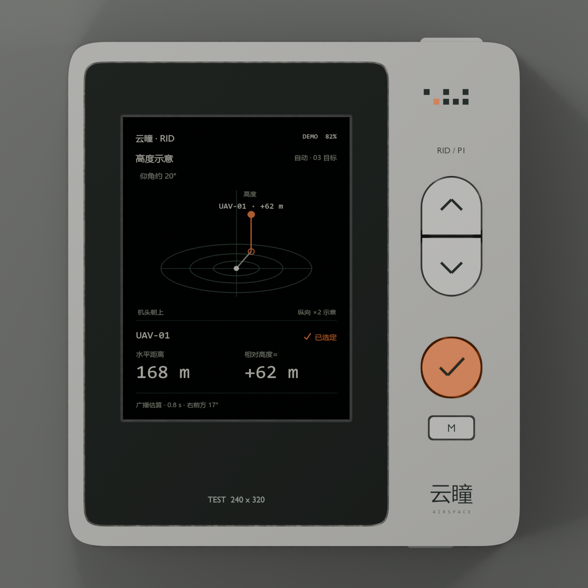
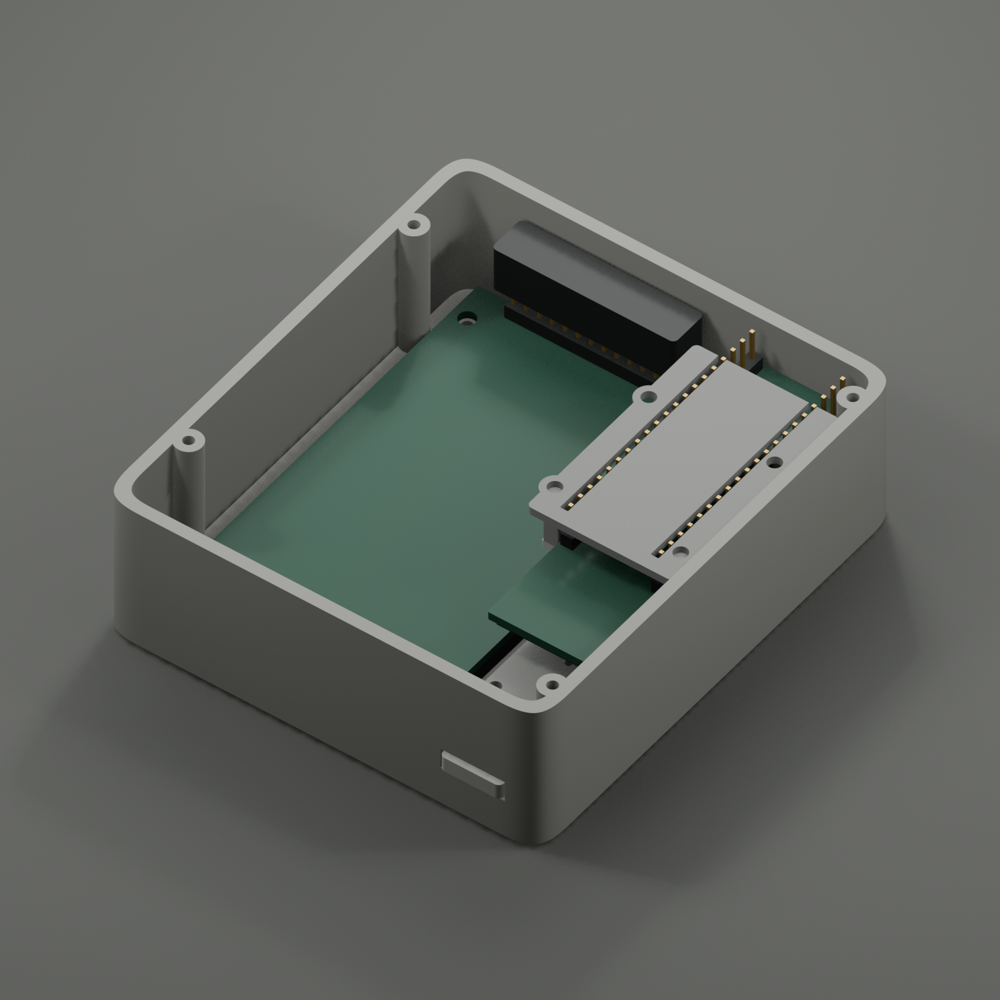
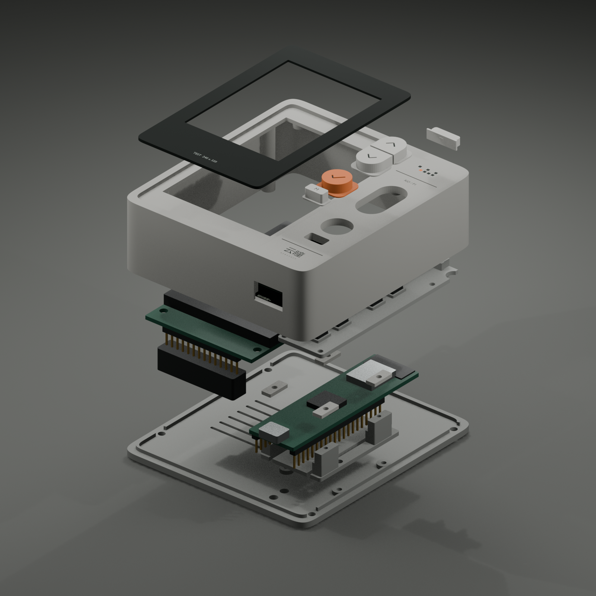

# 云瞳 RIG-P1 V3 · A1 风格可打印试装壳

> 已由 [V4](../v4/README.md) 替代。用户新要求全部焊线、居中 Type-C 延长座、总厚度不超过 28 mm；本 V3 的 32 mm 壳体和杜邦预留不再是当前方案。

2026-11-05，Blender MCP 实际建模与导出。当前分支：`codex/rig-p1-printable-shell`。

**用户已确认：照片里的细长 ESP32-P4-WIFI6 带排针版，配 MSP2834 2.8 英寸 SPI 屏。** 当前任务是验证现有器件，按 A1 审美做全打印测试壳。HY-A354TU102GG / 4-lane DSI 留作后续整机路线，不作为这套壳的装配输入。



## 先读：这套文件可以验证什么

已完成结构分件、毫米 STL、装配参考模型和实际 Blender 渲染；12 种导出网格均闭合、单连通、正体积。已建模零件与硬件包络之间的正体积干涉检查通过。**尚未实物打印、切片或装配，不属于经过实测验收的最终制造版。**

特别注意 P4 接线：本版保留排针，给裸针及屏端直式杜邦母头留了空间；**P4 端按低位软线接线设计，未计入满排长直式杜邦母头。** 当前模型的板端 GPIO 塑料座底面 Z=10.46，后盖内面 Z=2.4，仅有 8.06 mm。如果母头从塑料座向后突出 9 mm，会碰后盖，且现有托架通道只让裸针通过。若必须原样保留现有长母头接线，先量插接后的实际包络，再改后盖深度、托架通道及支撑；不要直接打印全套后硬合盖。低位焊接方案也需先确认实际引线位置与绝缘，当前没有替用户改焊硬件。

## 文件入口

| 文件 | 用途 |
|---|---|
| [yuntong-rig-p1-v3.blend](blender/yuntong-rig-p1-v3.blend) | 可编辑源模型，打开后选择 `RIG_P1_V3_Print` 场景；其他历史场景保留 |
| [yuntong-rig-p1-v3.glb](blender/yuntong-rig-p1-v3.glb) | 组装预览，含硬件简化包络与 UI 示意，不用于切片 |
| [stl/](stl/) | 12 种分件，坐标单位 mm，各自居中并落到 Z=0，已应用打印朝向 |
| [公差片 P12](stl/P12_fit_coupon.stl) | 优先打印；从左至右 Ø2.0 / 2.1 / 2.2 / 2.3 的螺钉试孔 |
| [design.json](design.json) | 结构尺寸、坐标、假设和未验证范围 |
| [Blender 审计](validation/blender-audit.json) / [实际 STL 审计](validation/stl-audit.json) | 检查证据及每个 STL 的 SHA-256 |
| [导出清单](validation/export-manifest.json) | 打印数量、包围盒、三角面数及体积 |

## 造型与包络

机身 **86 × 96 × 32 mm（宽 × 高 × 厚）**，不含顶部键 0.8 mm 的凸出。全打印暖灰外壳、下沉黑色前框、右侧上下分体胶囊键、橙色确认键、M 键、顶部辅助键、底部 Type-C。正面不设装配螺钉，背面四颗合壳螺钉。无金属漆或金属框，后续 CNC 材质路线仍以 A1/A2 为参考。

四角为每角两段三次贝塞尔原创曲线，直边连接处零曲率、对角连接处 C2 连续。不是苹果原厂 CAD。前后壳采用定位唇口，单侧间隙 0.3；外周合壳缝 0.3。壳体周壁 2.4，正面承力板约 3.0，黑框局部下沉槽另算。



2.8 英寸模块的 PCB 高 86 mm，显示区只有 57.6 mm 高，因此保留较宽的黑框上下边。不会把效果图中的黑框假称为整片无边框屏。

## 已核对的硬件尺寸

屏幕来源：[用户提供的原厂尺寸 PDF，归档原件](references/MSP2834-size.pdf)。

| MSP2834 项目 | 数值 / mm |
|---|---|
| PCB | 50.00 × 86.00 × 1.60 |
| 触摸/背光外形 | 50.00 × 69.20，顶边距 PCB 顶边 **6.40** |
| 触摸可视窗 VA | 43.60 × 58.05，顶边距 PCB 顶边 **9.14** |
| 显示 AA | 43.20 × 57.60，顶边距 PCB 顶边 **9.30** |
| 安装孔 | Ø3.20，孔距 44.00 × 76.08；上孔距上边 3.00，下孔距下边 6.92 |
| 总厚度 | 14.28，已包含 PCB 和排针，不能再把排针高度完整叠加一次 |
| 14P 排针位置 | 间距 2.54，跨度 33.02，距 PCB 下边 2.00 |

主板按 [Waveshare ESP32-P4-WIFI6 官方资料](https://docs.waveshare.com/ESP32-P4-WIFI6)及[归档尺寸图](references/ESP32-P4-WIFI6-size.webp)采用 **71.05 × 21.00 mm**，2×20 排针。用户已确认是照片中的这一细长带排针版。没有套用 85 × 56.5 的 DEV-KIT，也没有使用带 RJ45 的 Pico-M 包络。板厚、连接器及各元件高度为保守简化包络，未拿到完整厂家 STEP 或用卡尺复测。

## 分件与打印数量

| 编号 | 零件 | 数量 | STL 包围盒 / mm |
|---|---|---:|---|
| P01 | 一体正面/周边壳 | 1 | 86 × 96 × 29.3 |
| P02 | 后盖及定位唇口 | 1 | 86 × 96 × 4.0 |
| P03 | 黑色前框 | 1 | 57.6 × 88 × 1.2 |
| P04 | 五键定位托板 | 1 | 21.2 × 79.45 × 7.4 |
| P05 / P06 | 上 / 下键帽 | 各 1 | 12.9 × 11.2 × 4.8 |
| P07 | 橙色确认键帽 | 1 | 12.9 × 12.5 × 4.8 |
| P08 | M 键帽 | 1 | 10.1 × 5.5 × 4.8 |
| P09 | 顶部键帽 | 1 | 14 × 4.2 × 4.0 |
| P10 | 细长 P4 独立托架 | 1 | 30 × 45 × 10.85 |
| P11 | 主板压片，同件重复 | **4** | 4.4 × 10 × 1.4 |
| P12 | 试孔公差片 | 1 | 38 × 18 × 3 |

整机共 14 个打印件，加一件公差片。P05/P06 和 P07 的箭头/勾为实体凹刻，黑色填色需后处理；品牌、M 字、微小文字及棋盘标仅为渲染/丝印参考，不包含在 STL 中。

## 坐标与堆叠

组装坐标以机身平面中心为 XY 原点，正面朝 +Z，后壳外表面 Z=0。Blender 内部是米，下表为 mm；不要把整个场景直接按 1:1 米导入切片。独立 STL 已转换成 mm。

| 位置 | 数值 / mm |
|---|---|
| 前面 / 后面 | Z=32 / 0 |
| 后盖内面 / 定位唇顶 | Z=2.4 / 3.9 |
| LCD PCB | 中心 X=-11，Y=0；Z=24.9…26.5 |
| LCD 触摸前面 / AA 中心 | Z=30.8；X=-11，Y=+4.9 |
| 黑框前面 / 屏面凹入量 | Z=31.85 / 约 1.05 |
| LCD 排针尖 / 母头预留底面 | Z=16.52 / 7.52 |
| P4 PCB | 中心 X=26，Y=-11；Z=13…14.6，USB 朝底边 |
| P4 裸排针尖 | Z=4.46；距后盖内面约 2.06 |
| Type-C 壳体开口 | 宽 13.4，高 8.0，X=26，Z=12.6…20.6 |
| 按键托板 / 开关顶 | Z=21.9…23.5 / 27.7 |
| 键帽推杆底面 / 初始间隙 | Z=27.9 / 0.2 |

主板不依赖未知固定孔；由下部支撑与四个有硬止口的压片限位。压片与 PCB 名义间隙 0.25，可在实测后用薄绝缘垫消除晃动，不能用螺钉强行压弯 PCB。天线在打印壳内，无金属遮罩或新增外接天线孔。




## 五金与按键

以下为当前名义堆叠对应的螺钉起点，先在 P12 上试孔。树脂件宜手工预攻丝，PETG 选适合塑料的螺纹形式；不要直接用大扭矩拧入，或把未设计的热熔螺母硬压入。

| 位置 | 起始规格 | 数量 | 注意 |
|---|---|---:|---|
| 合壳 | M2.5 × 12，低头 | 4 | 后盖头部沉孔深 1.1；较高螺头会凸出，不承诺完全齐平 |
| LCD 固定 | M2.5 × 5 + 薄垫片 | 4 | 不换成更长螺钉顶穿盲孔或触碰屏幕 |
| 托架→后盖 | M2.5 × 4 | 4 | 柱内是盲孔，过长会顶穿后盖 |
| 按键托板→前壳 | M2 × 6 | 4 | 后侧装入 |
| 主板压片→托架 | M2 × 8 | 4 | 对角轻拧，压片应坐到硬止口 |
| 轻触开关 | 6 × 6，板面至按钮顶约 4.2 | 5 | 前面四个、顶部一个；焊脚方向与定位窝需试装 |

开关定位窝为 6.4 × 6.4；四个前键使用约 3.5 mm 本体加按钮至 4.2 mm 的参考堆叠。顶部开关横向安装于托板端部定位架，实际型号未冻结，需要少量柔性胶或可移除胶带辅助固定，并核对推杆行程。开关反力提供键帽回弹。

推荐功能：上下选目标/调量程，橙键锁定/确认，M 切视图/返回，顶键待机。**仅为按键定义，未开发对应固件、电源锁存或充电电路。**

## 打印与试装顺序

1. 先打 P12，确认孔径、螺纹和材料收缩，再单打 P10/P11 验证主板排针朝向、USB 插头和接线高度。尤其先处理前述 P4 板端接线约束。
2. 壳体可用 PETG、0.4 喷嘴、0.2 层高、4 道壁、约 20% 填充作为起点。小键帽、黑框及托架局部薄壁更适合韧性光固化树脂或 0.25 喷嘴；普通脆性树脂不适合反复紧固。
3. P01 已正面向下导出，黑框下沉面与侧孔存在局部悬空，需要在切片中审查局部支撑，避免支撑压伤可见面。P02 背面向下；P04/P10 底面向下；键帽正面向下时也要检查凹刻及支撑。不能笼统设置“全套无需支撑”。
4. 正面孔从内侧装入 P05…P09，由法兰防脱；安装五个开关与 P04。先试回弹和 0.2 名义行程间隙，必要时微调推杆或垫片，避免常按。
5. 从后腔安装 LCD，用四颗螺钉轻固；支撑落在 PCB 孔位，不挤压玻璃。外侧黑框用约 0.15 mm 胶带固定在定位槽中，不要粘住触摸有效区。
6. P10 安装于后盖，主板置入后装四件 P11。绝缘并整理线束，接线避开螺柱、天线区和按键行程。
7. 用 Type-C 实际插头试插，确认连接器与开口同轴；无夹线、按键正常后再合盖。最后再做打磨、喷涂、字标和凹刻填色。

没有提供未经切片验证的打印工时、材料用量或精度保证。整机不是防水结构，后盖通风槽和接口未密封。

## Type-C、电池和 GNSS 的边界

底部 Type-C 是主板已有接口的供电/下载通道。**有 Type-C 开口不代表有电池充电功能。** 用户的充电目标仍保留，但尚未提供电池、充电板、GNSS 和 IMU 的实物包络，这些没有假装装进当前壳体。新增电源/GNSS 后必须重做装配、天线净空、散热和续航验证；不要将当前空腔直接视为可用电池容量。

屏幕 UI 来自 A1 示意纹理，渲染不是 MSP2834 实机点亮照片，也不代表真实 RID/GNSS 数据。

## Blender MCP 接手

打开上方 `.blend`，当前场景应为 `RIG_P1_V3_Print`，主集合 `RIG3_Product`，硬件参考集合 `RIG3_Hardware_envelopes`。`part_id` 是可打印件标记；`reference_only`、`visual_detail` 和 `demo_only` 不是打印零件。P11 的三份实例仅为组装展示，导出只输出一个文件并注明打印四件。

本次通过活跃 Blender 5.2.1 LTS 的 MCP 执行，没有关闭 safe mode。Python 文件由宿主文件工具读取，再把源代码作为 `execute_blender_code.code` 传入；不要在 Blender 中用 `open/exec/os/subprocess` 读取运行脚本。`user_prompt` 采用用户原话“使用blender mpc”。

源脚本顺序：`01_geometry.py` → `03_details_studio.py` → `02_validate.py` → `04_export.py` → `05_render.py`。01 在同名场景存在时主动停止，03 在细节已存在时停止，防止覆盖或重复堆叠；现有模型应直接局部修改。03 的中文品牌网格来自保留的 `RID_ID_A1_Studio` 场景，重建时需要同文件的 A1 源对象。修改后的结构必须重新运行 02、04，再在宿主运行 06：

```powershell
python hardware/rid-handheld-rig-p1/v3/scripts/06_verify_stl.py
```

路径常量指向本机项目，移机时先修改 `OUT` 和 A1 纹理路径。屏幕纹理已打包进 `.blend`；GLB 也嵌入纹理。Blender 场景是米，STL 是毫米，GLB 仍按标准使用米。

当前验证范围：12 种实际 STL 各自 0 条非流形边、单连通、正体积、边方向一致、Z=0、包络单位正确；Blender 审计检查了 126 对存在包围盒重叠的实体，未发现大于 0.01 mm³ 的交叠。没有检查金属紧固件、未建模线束、电池或 GNSS，也未做自相交算法、最小壁厚分析、切片和实测装配。下一步应补齐实物测量和打印反馈。
