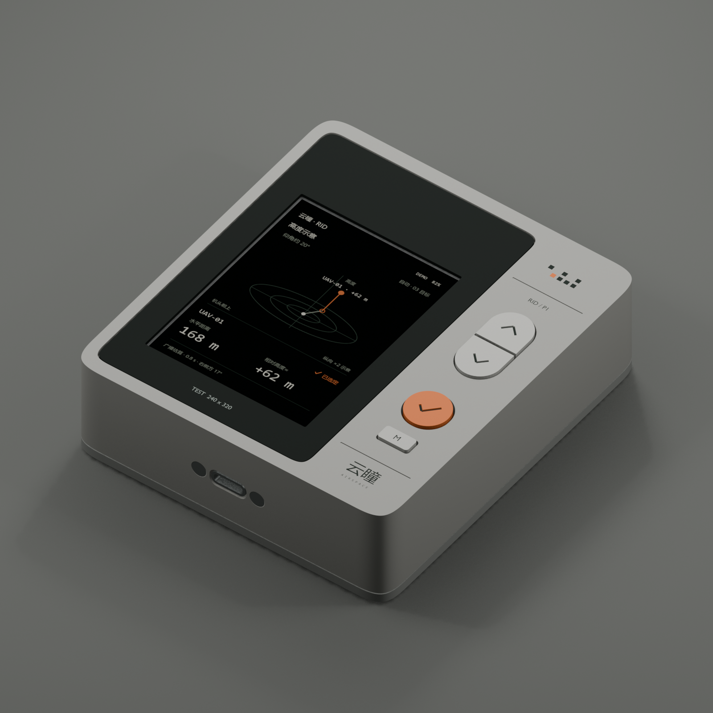
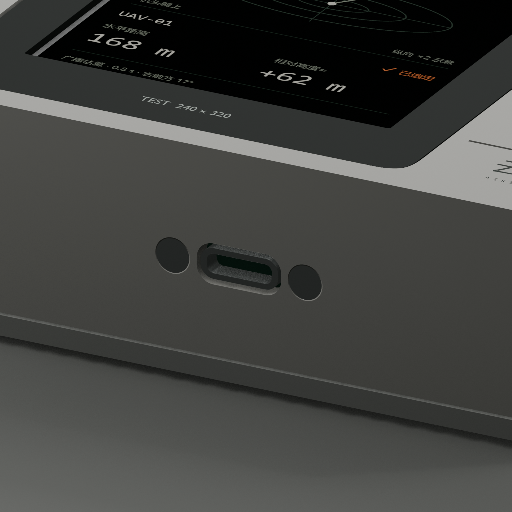
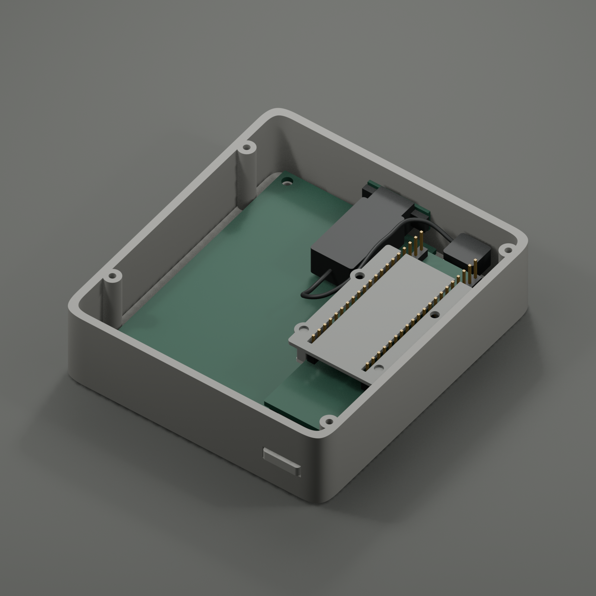

# 云瞳 RIG-P1 V4 · 28 mm 内焊线试装版

> **2026-11-06 原生 CAD 更新：** [整体原生 STEP 装配体](step/yuntong-rig-p1-v4-native-assembly.stp) 由 CadQuery/OpenCascade 直接按 V4 尺寸构造并导出，包含 14 个结构件；圆孔为精确圆柱面、圆角为圆弧/原生倒圆，四角为两段精确三次贝塞尔曲线。未读取 STL。源几何另存 [BRep](cad/yuntong-rig-p1-v4-native-assembly.brep)，重建脚本为 `scripts/native_common.py`、`native_shells.py`、`native_controls.py`、`native_board.py`，导出入口 `scripts/09_export_native_assembly.py`。旧 `yuntong-rig-p1-v4.stp` 是先前网格转换版本，当前应使用带 `native-assembly` 的文件。

2026-11-05。通过用户的活跃 Blender MCP 建模、检查、渲染和导出。当前分支 `codex/rig-p1-printable-shell`。

**当前输入：照片中的细长 ESP32-P4-WIFI6 带排针版；MSP2834 2.8 英寸 SPI 屏；全部信号线焊接；底部居中 Type-C 面板延长线。屏幕含插头总高按用户给出的 14 mm，开发板含插头总高按 14.5 mm。整机厚度上限 28 mm。**



| 项目 | 当前名义尺寸 |
|---|---|
| 外壳宽 × 高 × 厚 | **86 × 96 × 27 mm** |
| 包含正面凸起按键的总厚度 | **27.7 mm** |
| 到 28 mm 上限的加工余量 | 0.3 mm，喷涂及实际打印正公差共同占用 |
| Type-C 中心 | 宽度方向 X=0；厚度方向 Z=13.5 mm |
| 顶部键凸出 | 高度方向额外 0.8 mm，不增加厚度 |

当前是**待实物验证的结构试装版**。数字模型满足厚度约束；尚未打印或切片，不能将 27.7 mm 当成已实测尺寸。后盖应使用头高不超过 1.6 mm、能沉入孔内的螺钉，禁止另加厚脚垫后仍宣称总厚度不变。

## 文件

| 文件 | 用途 |
|---|---|
| [Blender 源文件](blender/yuntong-rig-p1-v4.blend) | 当前场景 `RIG_P1_V4_Print`，保留 A1、V2、V3 历史场景 |
| [GLB 组装预览](blender/yuntong-rig-p1-v4.glb) | 含简化电子器件及接线示意，不用于打印 |
| [13 种 STL](stl/) | 已按 mm 导出、各自居中并落到 Z=0 |
| [P13 接口试装片](stl/P13_usb_fit_coupon.stl) | 先试装 Type-C 延长座、孔距与沉头螺钉 |
| [P12 试孔片](stl/P12_fit_coupon.stl) | 从左至右 Ø2.0 / 2.1 / 2.2 / 2.3 |
| [结构参数](design.json) | 当前输入、位置和未验证事项 |
| [Blender 审计](validation/blender-audit.json) | 13 种闭合零件、178 对包络干涉检查、27.7 mm 厚度 |
| [实际 STL 审计](validation/stl-audit.json) / [清单](validation/export-manifest.json) | 独立读取二进制 STL，检查单位、流形、方向、连通性、体积及 SHA-256 |

## 结构变化

沿用 A1 的左侧黑框、右侧胶囊上下键、橙色确认键、M 键、顶部键、字标及原创连续贝塞尔四角。测试壳采用全打印暖灰外壳和独立黑色前框，不改变后续 CNC 围框的外观目标。

屏幕与开发板在平面内并排，避免把 14 与 14.5 mm 叠成 28.5 mm。屏幕相对 V3 在平面内旋转 180°，14P 接线端移到顶部，空出底部居中接口及尾套的位置。**固件需要对应旋转显示/触摸坐标；渲染中的 UI 只是正向示意。** 黑框开窗中心改为 X=-11、Y=-4.9。

开发板向机身顶部移动 12 mm，板载 Type-C 转为内部连接，不再在壳体右下角开外露孔。延长线面板母座安装在机身底边正中，弯头公头接到板上。所有信号线按焊线处理，已删除屏端杜邦母头的 9 mm 额外预留。焊点应从排针侧面/根部引线，在 14.5 mm 总包络内走线；不要在最低针尖向后叠加锡团、厚热缩管或线束。




## 厚度预算与坐标

以背面为 Z=0，正面朝 +Z，XY 原点为机身中心。下表单位均为 mm；Blender 内部坐标仍为米。

| 层 / 元件 | Z 范围 | 说明 |
|---|---|---|
| 后盖主体 | 0…2.4 | 定位唇口最高 3.9 |
| 开发板总包络 | **2.7…17.2** | 高 14.5，含现有插头/排针；PCB 分配 12…13.6 为试装假设 |
| PCB 下排针尖至后盖 | 0.3 间隙 | 不增加杜邦母头 |
| 开发板最高点至按键板底 | 0.4 间隙 | 17.2→17.6 |
| 按键托板主体 | 17.6…18.8 | 厚 1.2 |
| 前面轻触开关 | 18.8…23.0 | 6×6，本体至按钮顶合计约 4.2 |
| 开关顶至键帽推杆 | 0.2 间隙 | 推杆底 23.2 |
| 屏幕整体 | **11.8…25.8** | 高 14.0；最低点为顶部接线端针尖 |
| 屏幕 PCB | 19.9…21.5 | 50×86×1.6 |
| 黑框前面 | 26.85 | 屏面凹入约 1.05 |
| 外壳正面 | 27.0 | 主体厚度 |
| 正面键帽最高点 | **27.7** | 全部打印件组装后的厚度极值 |

屏幕孔位为 (-33,-40)、(11,-40)、(-33,36.08)、(11,36.08)。开发板 PCB 为 21×71.05，中心 (26,1)，USB 朝底边。板端排针可保留，靠焊线连接，不假设用户一定剪针或拆排针。

用户给出的 14 / 14.5 是本版优先输入。屏幕原图纸还标有总厚 14.28，归档见 [原尺寸 PDF](references/MSP2834-size.pdf)；其与用户 14 mm 输入的差异需试装对照。开发板参考 [Waveshare 官方资料](https://docs.waveshare.com/ESP32-P4-WIFI6)和[归档图](references/ESP32-P4-WIFI6-size.webp)。没有完整厂家 STEP 或实测 PCB 两侧各自高度，托架支撑位置仍需拿实物确认。

## Type-C 面板件

截图原件：[尺寸图](references/USB-C-panel-dimensions.png)。已采用截图中的 **20×6.7 mm、16 mm 固定孔距、约 Ø2 mm 孔、20–30 mm 尾部长度**。机身槽孔为 10.2×4.8，沿 XZ 平面圆角，中心 (0,13.5)；固定孔为 Ø2.2，中心 X=±8。两颗 M2 沉头螺钉从外侧装入，螺母位于面板后侧，避免直接依赖薄塑料壁的螺纹。

预留最深 30 mm 尾套。**尾套宽 14、高 9，近面板颈部宽 11、长 6，面板厚 1，以及弯头公头 10×9×6 都是暂定包络，截图没有完整标明这些值。** 前 6 mm 缩颈用于避开 M2 螺母；如果实物更宽或热缩管形状不同，不能强塞。优先打印 P13 安装实物，并测尾套横截面、弯头和螺母能否就位，再打印整壳。完整尾套比 P13 更深，P13 仅验证前端安装孔与插口。

黑色线条为延长线走向示意，不是已验证的扁排线弯折形状/半径。实际焊点、热缩管和软排线沿空腔整理，不应进入开关行程或压在 PCB/针尖上。Type-C 延长不新增充电电路；该测试版仍使用板载 USB 的供电/下载能力。

## 打印件与五金

P01 前壳；P02 后盖；P03 黑框；P04 按键托板；P05/P06 上下帽；P07 橙色帽；P08 M 帽；P09 顶键；P10 主板托架；**P11 压片打印 4 件**；P12/P13 是试装片。整机 14 个打印件，另加 2 个试装片。详细尺寸见导出清单。

| 位置 | 名义五金 | 数量 |
|---|---|---:|
| 合壳 | M2.5×12，头高 ≤1.6，头部直径需小于 5.3 | 4 |
| LCD | M2.5×5 + 薄垫片 | 4 |
| 托架→后盖 | M2.5×4 + 约 0.5 垫片，避免顶穿盲孔 | 4 |
| 按键托板 | M2×6 | 4 |
| 主板压片 | M2×8 | 4 |
| USB 面板座 | M2×6 沉头 + M2 螺母，按实物厚度复核长度 | 2 套 |
| 轻触开关 | 6×6，总高约 4.2；顶部一只横置 | 5 |

螺钉选型是当前名义堆叠的起点，先用 P12 试孔。树脂件先手工预攻丝，托架薄壁和压片不得大扭矩紧固。主板压片名义上方限位间隙 0.25，有硬止口，必要时加薄绝缘垫，不拧弯 PCB。顶部开关在定位架内需可移除胶带或少量柔性胶辅助固定。

壳体可用 PETG 0.4 喷嘴、0.2 层高、4 道壁作为起点；薄黑框、小键帽及细托架优先用韧性 SLA 或更细喷嘴试样。STL 已落地并设置朝向，仍需逐件审查局部支撑，尤其前壳的下沉黑框槽、USB 横孔和键帽法兰。未切片，不提供虚构工时。

先试 P12/P13 → 托架与实板 → 前盖与屏幕 → 五键回弹 → 焊线及 USB 实际插头 → 合盖测厚。完成打磨喷涂后再测一次总厚度，控制在 28 mm 内。

箭头和勾为实体凹刻，黑色填色另做；品牌、M 字及微小字标是渲染/丝印参考，不在 STL 内。屏幕上的数值来自 A1 示意纹理，没有宣称已点亮实屏或完成 RID 功能。

## Blender MCP 接手及检查

源文件场景 `RIG_P1_V4_Print`，产品集合 `RIG4_Product`，简化硬件集合 `RIG4_Hardware_envelopes`。`part_id` 是打印件标记；`fit_only` 是试装片；`reference_only` 是硬件包络；`visual_detail` 是渲染细节。旧场景和旧资产未覆盖。

脚本顺序：01 几何 → 03 材质/细节 → 03b USB 细节 → 02 检查 → 04 STL → 05 渲染 → 07 保存。已有场景不要重跑 01/03/03b，直接局部修改。03 复用保留的 A1 中文品牌网格；路径常量按新电脑修改。图像已打包到 `.blend` 和 GLB。

通过 MCP safe mode 执行：用宿主文件工具读源码，再把完整代码传给 `execute_blender_code`。不要在 Blender 中调用 `open/exec/os/subprocess`。`user_prompt` 使用用户原话“使用blender mpc”。后续修改结构后重新导出，并从宿主独立验证：

```powershell
python hardware/rid-handheld-rig-p1/v4/scripts/06_verify_stl.py
```

已通过：13 种实际 STL 各自单连通、正体积、0 条非流形边、方向一致、正确 mm 包络和 Z=0；组装打印件极值 27.7；178 对存在包围盒重叠的结构/硬件跨组组合未发现大于 0.01 mm³ 的实体交叠。检查有意排除属于同一组件的重叠包络及 USB 插头与插座的配合接触。线束图、未给定尺寸的元件、实际螺纹、最小壁厚、自相交算法和实物装配不在已完成验证中。

电池、充电板、GNSS、IMU 没有获得实物包络，未加入当前壳体，不将空腔假称为已验证电池仓。本版聚焦现有 P4+2.8 屏的薄壳验证。
