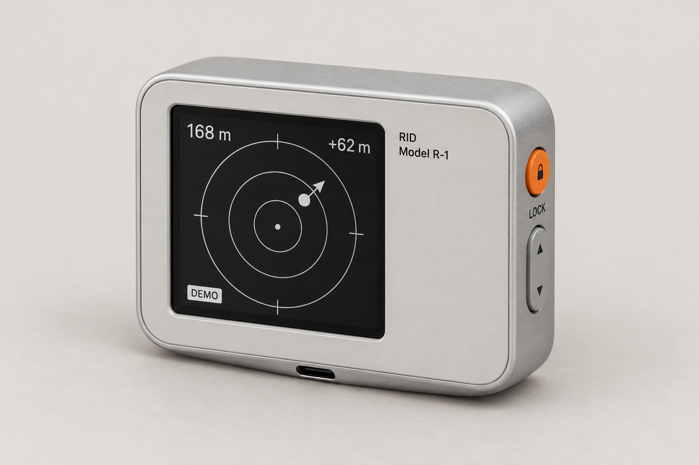
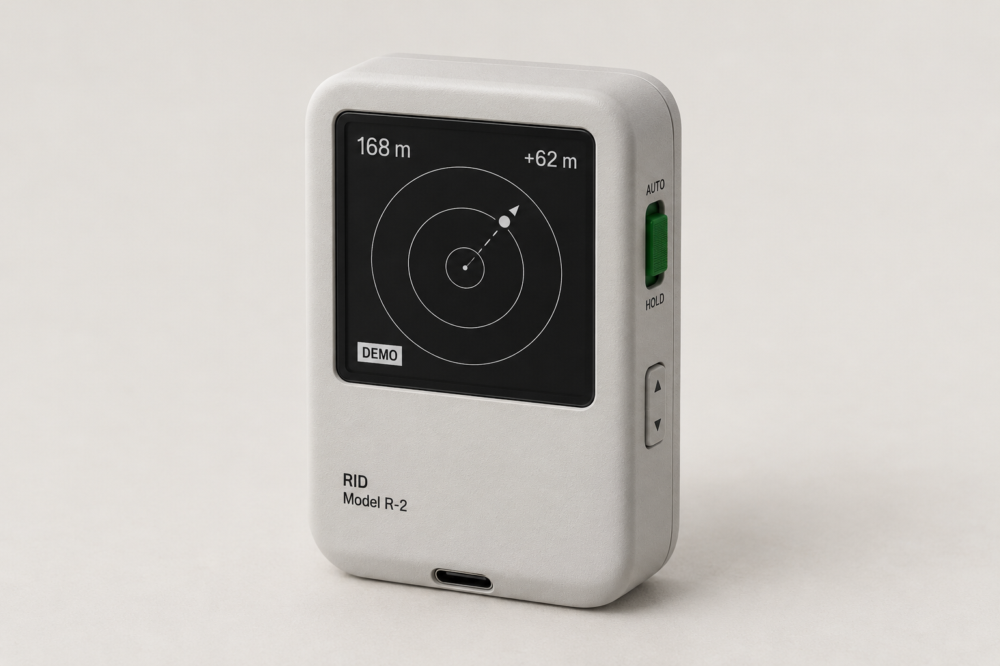
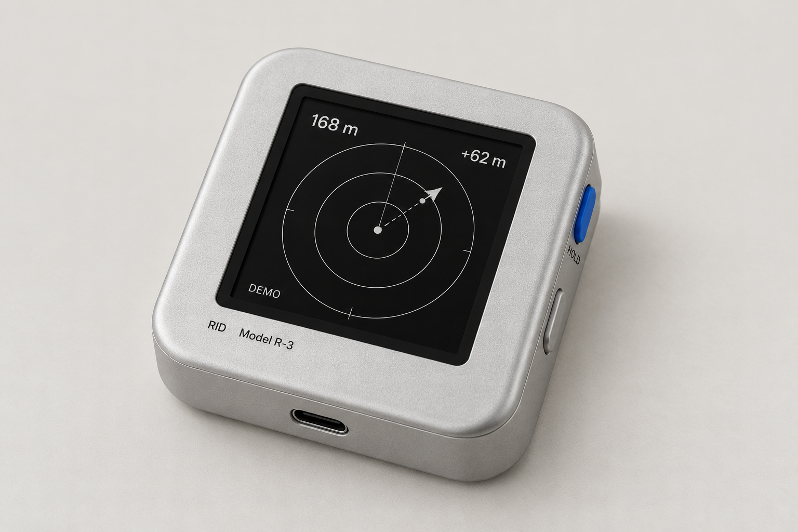

# 云瞳 RID · Rams / Braun 风格概念选项

2026-10-30。按用户要求先做生图供选择。使用内置 `image_gen`，三款各独立生成一张，未使用 CLI。完整原始提示词保存在 [prompts.json](prompts.json)。

共同方向：小型便携 RID 接收器、方形黑白界面、AM200Q460460FLS1 屏幕作为概念输入、连续曲率四角、侧边实体操作、底部 Type-C、Helvetica 风格小字、浅灰暖色影棚。每款只有一个有色功能控件。

## A · 橙色圆键 / 横向仪器

灰白内嵌面板与银色包覆铝壳，右侧橙色圆键用于目标锁定，灰色上下键用于选择目标。最接近既有项目的金属包覆方向；通过取消正面复杂按键、装饰刻纹和图案，强化安静、清楚的仪器感。优先推荐此方向。

概念提示中的目标比例：约 64 × 54 × 20 mm。

## B · 森林绿滑钮 / 纵向随身仪

灰白哑光聚碳酸酯，绿色 AUTO / HOLD 滑钮表达自动与保持状态，侧边灰色上下键选择目标。更亲和，控制状态能通过滑钮位置直接表达。

概念提示中的目标比例：约 54 × 64 × 20 mm。

## C · 钴蓝条键 / 方形铝壳

近方形缎面铝壳，居中的方形屏，右侧钴蓝色条形 HOLD 键，灰色选择键。最强调纯粹几何和正面的整洁，视觉更偏当代。

概念提示中的目标比例：约 58 × 58 × 20 mm。

## 本轮边界

三图为生成式外观概念，屏幕读数标注 DEMO；图片中的比例、接缝、纹理与接口尚不是精确工程尺寸，字体也未经过字库级验证。用户选定方向后，再将形态、CMF、字标和控制位置落实到 Blender / CAD，并依据实际屏幕与 FPC 复核内部装配。

本轮没有选择或替用户冻结 A、B、C 中的任何一款。原图保留在 image_gen 默认目录，同时复制至本文件所在项目目录。
