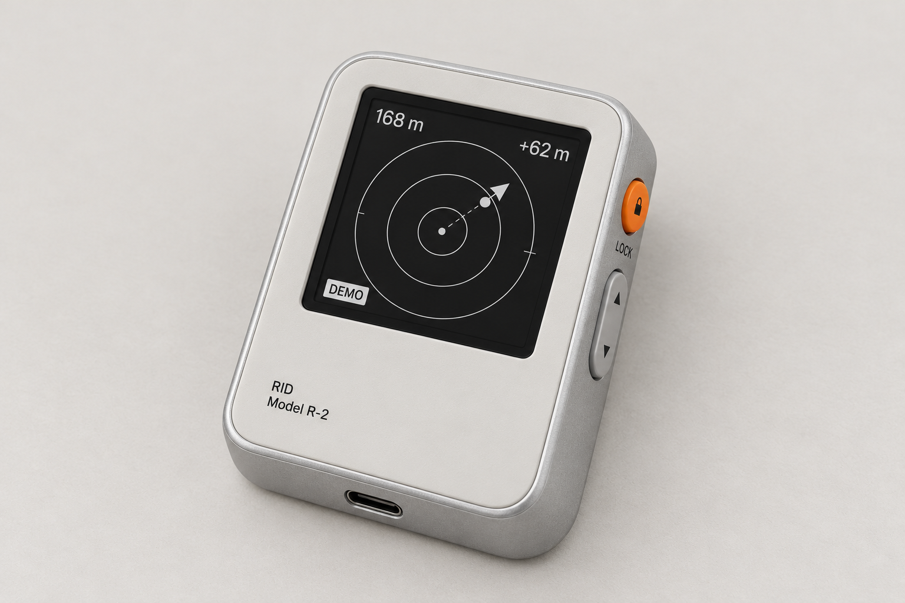
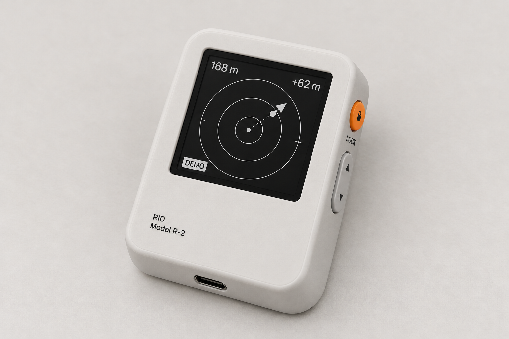

# RID 竖式组合方案 · 两种外壳材质

2026-10-30。根据用户选择，把上一轮 2 的竖式布局、1 的侧边按键、3 的底部 Type-C 合并，再生成同视角的两种材质结构。

共同设计：方形屏位于上方；下方左对齐小字 RID / Model R-2；右侧上方为橙色圆形锁定键，下方为灰色胶囊形上下键；唯一 Type-C 接口放在底部端面中央。屏幕为黑白 DEMO 界面。

## A · 铝合金中框 + 光固化打印前后盖

细哑光银色铝框包围灰白色打印前盖；后盖同为光固化树脂打印件。铝框在正面保留一圈细窄可见边缘，延续金属包覆感。前后盖采用后固化、打磨后的均匀哑光外观。

## B · 全光固化打印外壳

把 A 的铝框、外沿和侧壁统一改为灰白色光固化树脂，保留相同的竖式形态、侧边按键与底部接口。外观整体、柔和；内部的 Type-C 金属连接器仍保留正常金属材质。

## 生成记录

使用内置 `image_gen`，未使用 CLI。A 使用上一轮三张图片作为分工明确的参考；B 以生成的 A 为编辑目标，仅改变外壳材质及接缝表现，以保持比较视角一致。完整提示词见 [prompts.json](prompts.json)。

A 的原始生成文件：`C:/Users/YX/.codex/generated_images/01a1867d-9ed6-7162-a95e-55b83169a1c8/exec-5fa8f1ac-d734-49e5-acb2-c1690e6cc7f3.png`。

B 的原始生成文件：`C:/Users/YX/.codex/generated_images/01a1867d-9ed6-7162-a95e-55b83169a1c8/exec-8eccc3f5-4b21-4607-beb0-b5e4dd797e09.png`。

图片是外观与材质方案；后盖在该视角下大部分不可见，其材质为设计输入。尚不是尺寸、公差、树脂材料性能或装配可行性的验证。
